# Is Folding Worth the Storage?

## Curved and Shrinking Space-Time Gaussians for Video

**Chen Hongshan**
CP4282 3D Gaussian Splatting, AY26/27 Semester 1, National University of Singapore

Code: <https://github.com/ChenHongshan333/cp4282-project> · Project website: <https://chenhongshan333.github.io/cp4282-project/> · Reproduction: Appendix A.1

## Abstract

Curved paths and shrinking allow each space-time Gaussian to evolve over time; however, curved paths incur extra storage overhead for every Gaussian. To evaluate whether these capabilities provide a net benefit under a fixed storage budget, a straight-path baseline was compared against curved, shrinking, and combined models under equal total storage constraints on short UVG clips. PSNR was measured both on fitted frames and on frames held out during fitting. After 3,000 training steps, both shrinking and the combined model outperformed the baseline by 0.5 to 2.3 dB. With full training, however, the baseline caught up, and none of the three variants maintained a consistent whole-frame advantage. Crucially, similar early gains observed on still photographs suggest that much of this initial edge stems from faster optimization rather than the recovery of true physical motion. On the other hand, curved paths did improve temporal interpolation on held-out frames—achieving up to approximately 9 dB gain on strongly curved synthetic motion and averaging approximately 0.5 dB on moving objects in real clips, albeit without consistent whole-frame improvements. Under the tested conditions, folding thus fails to improve overall reconstruction efficiency at equal storage once fully trained; its primary benefit lies in interpolation, with modest, localized gains on real-world video.

---

## 1 Background

### 1.1 Video Representation via Space-Time Gaussians (Unit 16)

In [Unit 16](https://weitsang.github.io/gaussian-splatting-notes/unit-16/), a short video sequence is represented as a summation of continuous, colored 3D Gaussians spanning both spatial and temporal domains. Each **space-time Gaussian** - defined over spatial coordinates $(x, y)$ and time $t$ - is characterized by its center position, spatial footprint, color, and temporal duration.

A space-time Gaussian exhibits transient visibility: its amplitude peaks at time $t_0$ and decays smoothly before and after. Throughout its lifespan, the Gaussian undergoes linear translation at a constant velocity $v$ while maintaining a fixed spatial covariance. To render a video frame at time $t$, each Gaussian is evaluated at that timestamp to yield a 2D spatial slice, defined by its instantaneous position and attenuated opacity. The final frame is synthesized by blending these 2D slices. Fitting a video model thus entails optimizing the parameters of all Gaussians via gradient descent to minimize the discrepancy between the synthesized frames and the ground truth.

Geometrically, the video can be seen as a block of frames stacked along the time axis, with $x$ and $y$ across each frame. A space-time Gaussian occupies an elongated region of this block, and the path of its centre runs through that region over time. Each frame is a plane at a fixed time $t$ that cuts the region; the cut is the 2D slice drawn in that frame, an ellipse centred on the path at time $t$. The slice is brightest at $t_0$ and fades in the frames before and after, more slowly for a larger duration $\sigma_t$, so a long-lived Gaussian contributes to more frames. The velocity $v$ tilts the path through the block: the faster the Gaussian, the further its slice moves from one frame to the next, always along a straight line.

Under this formulation, storing a video requires persisting the parameters of every constituent Gaussian. In Unit 16, each Gaussian is parameterized by 12 values (Table 1), incurring a fixed storage overhead of 12 parameters regardless of its temporal span. Consequently, the total storage capacity scales directly with the number of Gaussians.

**Table 1.** The numbers stored for one Gaussian in Unit 16.

| Centre $(x, y)$ | Peak time $t_0$ | How long it is visible ($\sigma_t$) | Velocity $v$ | Shape | Colour (red, green, blue) | Total |
|:---:|:---:|:---:|:---:|:---:|:---:|:---:|
| 2 | 1 | 1 | 2 | 3 | 3 | **12** |

### 1.2 Non-Linear Motion Dynamics

Real-world videos frequently exhibit complex non-linear motions that cannot be accurately captured by constant velocity assumptions. For instance, a galloping horse rapidly swings its legs back and forth across a few frames, while a dog shaking off water alternates its head and body rotation (Figure 1). Because linear Gaussians can only approximate such trajectories over extremely brief intervals, baseline methods are forced to partition complex trajectories, relying on a sequence of short-lived Gaussians to cover a single continuous motion.

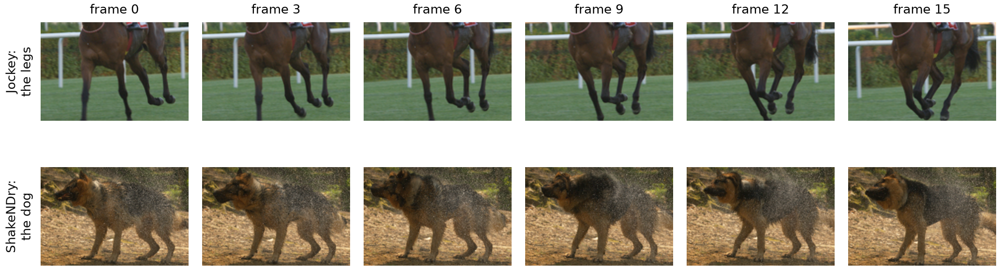

**Figure 1.** Every third frame of two UVG clips used in this project. Top: the horse's legs swing forward and back. Bottom: the dog turns its head and body back and forth. The crop follows the animal from frame to frame.

### 1.3 VeGaS: Folded-Gaussians Representation

To address the limitations of linear motion models, VeGaS (Video Gaussian Splatting; Smolak-Dyżewska et al., 2024) extends space-time Gaussians through a novel formulation termed **Folded-Gaussians**, introducing two key modifications. First, the trajectory of the 2D slice's center is modeled using a higher-order polynomial function of time (typically 7th-degree by default) rather than a linear trajectory, allowing a single Gaussian to traverse a non-linear path. Second, spatial extent is dynamic, as the 2D slice is scaled by its temporal weight, causing the Gaussian to contract as its opacity fades. VeGaS achieves superior reconstruction quality (measured in PSNR) compared to prior video representations, with a primary application toward photorealistic video editing.

PSNR (peak signal-to-noise ratio), which is also the main score of this project, compares a reconstruction with the original as $10 \log_{10}(\mathrm{MAX}^2 / \mathrm{MSE})$, where MAX is the largest pixel value and MSE the mean squared error. Higher is better; a gain of 3 dB halves the mean squared error.

### 1.4 Critical Analysis and Motivation

While VeGaS demonstrates the benefits of polynomial motion trajectories - reporting a reconstruction PSNR of 38.53 dB for a 7th-degree trajectory versus 38.15 dB for a linear baseline (1st-degree) - this performance gain is conflated with an increased storage footprint. A 7th-degree Gaussian mandates additional parameters per primitive, and the reported 7th-degree model utilizes a larger overall Gaussian count (0.62M vs. 0.57M). Consequently, the observed PSNR improvements may stem primarily from increased model capacity rather than trajectory non-linearity alone. Furthermore, the contribution of dynamic scaling (shrinking) remains unisolated in ablation studies, and total model storage sizes were omitted from the analysis.

Under a strict Iso-Storage condition (equal total parameter budget), introducing folded trajectories presents a fundamental trade-off. Parameterizing non-linear trajectories reduces the total allocation of Gaussians available to represent the scene. Moreover, this parameter overhead is uniformly applied, burdening static or linearly drifting background regions (e.g., camera pans) with unnecessary higher-degree parameters. This project systematically investigates this trade-off to evaluate whether allocating parameter budgets toward non-linear trajectory representation outperforms simply expanding the primitive count of linear Gaussians (see the [project proposal](docs/assets/CP4282_project_proposal_hongshan.pdf)).

---

## 2 Research questions

The trade-off described above leads to two primary questions about representation efficiency and one supplementary question about temporal interpolation.

### 2.1 Primary Focus: Representation Efficiency under Capacity Constraints

> **Q1.** Under a fixed storage budget, does Gaussian folding provide a net benefit in reconstruction quality over linear space-time baselines?

*Context and metric.* Treating fitted Gaussians as a compact scene representation, each model is evaluated by its reconstruction PSNR on training frames under an identical total parameter/storage footprint. This explicitly tests whether parameterizing dynamic trajectories (curved paths, dynamic temporal scaling, or both) outweighs the loss of spatial resolution caused by reducing the total primitive count.

> **Q2.** If trajectory folding yields performance gains, are these improvements driven specifically by superior motion modeling?

*Hypothesis.* If gains stem from faithful physical trajectory modeling rather than generic capacity allocation, the PSNR advantage should scale with scene motion magnitude (higher velocity and curvature) and concentrate overwhelmingly within dynamic foreground regions rather than static/linearly drifting backgrounds.

### 2.2 Supplementary Analysis: Temporal Interpolation Capability

> **Q3.** Does non-linear trajectory modeling improve reconstruction accuracy on unseen intermediate frames (video frame interpolation)?

*Context and rationale.* When trained on temporally sub-sampled frames (e.g., at a stride of 3: frames $0, 3, 6, \dots$), a linear baseline may approximate complex curves on the training frames with a sequence of short-lived Gaussians. If so, it should draw the unobserved intermediate timestamps ($1, 2, 4, 5, \dots$) poorly, while a model that has captured the motion should not. These frames are scored with the same models and the same storage as in Q1, so a gain here is direct evidence on whether folded models capture the underlying motion dynamics (informing Q2).

---

## 3 Experiment design

This section describes the experimental design: the evaluated models, the test sequences and their motion, the protocol for each research question, and the optimization and reporting procedures.

*Note.* Unless marked otherwise, the design was fixed in the proposal prior to execution; the quantitative interpolation analysis in Section 3.5 was added post hoc. Methodological modifications developed after observing initial results are detailed in Section 4.

### 3.1 Model variants and controlled factors

The VeGaS architecture combines curved trajectories and shrinking within a single model, making it impossible to isolate their individual effects. To address this, the design factorizes the representation into two orthogonal components: the trajectory of the centre (straight or quadratic) and shrinking (disabled or enabled). This yields four model variants (Table 2). In every model the spatial shape is stored as a Cholesky factor $L$: a lower-triangular matrix with a positive diagonal such that $LL^\top$ equals the covariance. Storing $L$ (3 numbers for a 2D Gaussian) keeps the covariance symmetric and positive definite during optimization.

**Table 2.** The four models. Here $\tau = t - t_0$, $w(t)$ denotes the slice weight at time $t$, and $L$ is the Cholesky factor governing spatial shape.

| Model | Centre position at time $t$ | Shape (covariance) at time $t$ | Storage per Gaussian (scalars) |
|---|---|---|:---:|
| M0 straight (Unit 16 baseline) | $\mu + v\tau$ | $LL^\top$ | 12 |
| M1 curved | $\mu + v\tau + a\tau^2$ | $LL^\top$ | 14 |
| M2 shrinking | $\mu + v\tau$ | $\max(w(t), s_{\min}) \cdot LL^\top$ | 12 |
| M3 both | $\mu + v\tau + a\tau^2$ | $\max(w(t), s_{\min}) \cdot LL^\top$ | 14 |

For the curved trajectory, a quadratic path is selected as the minimal non-linear formulation by adding a constant acceleration $a$ to the velocity $v$, incurring 2 additional scalars per Gaussian. Shrinking scales the spatial slice by its weight $w(t)$ above a floor $s_{\min}$ to prevent total vanishing, incurring no extra storage cost. The fading weight $w(t)$ itself is shared by all four models; shrinking adds only the change of size.

Comparing M1 against M0 evaluates the curved trajectory, and comparing M2 against M0 evaluates shrinking; these are the two main comparisons. M3 shows the combined effect; no separate pass criterion for M3 was fixed in the proposal.

In the picture of Section 1.1, the four models differ as follows. In M1 the path of the centre through the block of frames is a parabola instead of a straight line, so the slice can change direction as it moves; the acceleration $a$ sets how strongly the path bends. In M2 the path stays straight, but the slice shrinks as it fades: its covariance is scaled by its weight $w(t)$, never below the floor $s_{\min}$, so the slice has its full size at $t_0$ and becomes smaller in the frames where it fades in and out. M3 does both.

**Controlled factors across all variants.** The renderer, loss objective (mean squared error across fitted frames, optimized jointly), Adam optimizer, iteration counts, spatial resolution, temporal sequence length and random seeds are held identical. For each seed, the Gaussians that two models share start from the same parameters: M1 starts from the first Gaussians of M0, with the acceleration set to zero, so at initialisation the two models differ only in the number of Gaussians. No Gaussians are added or pruned during optimization, preserving exact budgeted counts. Adam (Kingma and Ba, 2015), the optimizer used throughout, is a gradient-based method that scales the step of each parameter using running averages of its gradient and of the squared gradient.

**Higher-degree extensions.** As a supplementary extension, polynomial paths of higher degrees are evaluated. A path of degree $d$ requires $12 + 2(d - 1)$ scalars per Gaussian: degree 3 (D3) costs 16 scalars and degree 7 (D7, the VeGaS default) costs 24. Comparing degrees 1, 2, 3 and 7 (M0, M1, D3, D7) under an equal storage budget tests whether the performance gains reported in the VeGaS ablation persist once storage overhead is controlled. These models lie outside the primary 2×2 design.

### 3.2 Data and motion characterization

All test clips are drawn from the UVG dataset (Mercat et al., 2020), sixteen 4K test sequences captured at 50 or 120 frames per second by the Ultra Video Group for video codec analysis and development and released under the CC BY-NC 3.0 licence; the video frames shown in this report come from these sequences. The clips are taken at 1080p and 120 frames per second and downsampled to 480×270 resolution as in Unit 16.

Each clip spans 10 frames. At stride 1 these are consecutive frames; at stride 3, every third frame is retained (0, 3, 6, …, 27). Stride 3 widens the interval between observed frames, so the displacement between neighbouring sampled frames, and its change from one pair to the next, grow, while frame count and visual content are preserved. Each sequence is evaluated at both stride 1 and stride 3.

To determine whether performance gains follow motion characteristics, sequences with curved trajectories were selected alongside a control sequence exhibiting straight motion. Sequence roles were assigned following visual inspection.

| 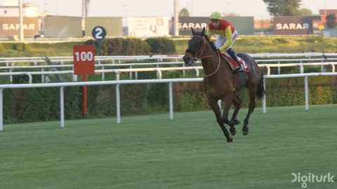 | 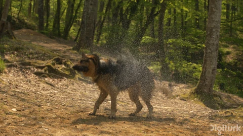 | 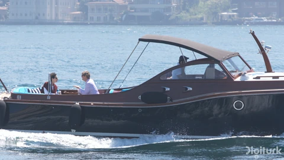 | 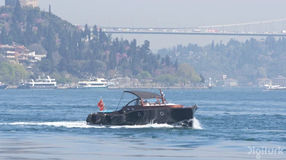 |
|:---:|:---:|:---:|:---:|
| **Jockey.** The camera pans alongside a galloping horse whose legs swing. | **ShakeNDry.** A stationary camera captures a dog shaking off water. | **YachtRide.** The camera follows a boat on open water. | **Bosphorus.** The camera follows a small boat on calm water. |

The four test sequences and their roles:

| Clip | Role in the study |
|---|---|
| Jockey | Primary case, as in Unit 16 |
| ShakeNDry | Highest bend: where curved paths should provide maximum benefit |
| YachtRide | Planned as the straight control; the waves bend its motion, so it is retained for the boat motion |
| Bosphorus | Straight-motion control, added after measurement; its motion is also slow, so straight motion and low speed cannot be decoupled |

The proposal specified confirming these roles prior to the main runs by quantifying motion via optical flow (Farnebäck, 2003), with any sequence failing to match its intended role being replaced. Optical flow estimates how far each pixel moves from one frame to the next; Farnebäck's method approximates the neighbourhood of each pixel in both frames by a quadratic polynomial and reads the displacement from how the polynomial shifts. Speed is the mean displacement per frame across the image plane; acceleration is the frame-to-frame change of displacement, measured along feature trajectories; and bend is acceleration divided by speed, so a higher bend indicates a greater departure from steady, straight motion. The measurement showed that YachtRide's motion is not straight, so Bosphorus was added as the straight-motion control before the main experiment. The measured values are given in Table A2 (Appendix A.2).

Additionally, a 30-frame clip of Jockey at stride 1 is included with tripled storage budgets to test a longer clip.

### 3.3 Reconstruction under a fixed storage budget

This part of the design addresses Q1 (Section 2.1): under a fixed storage budget, does Gaussian folding provide a net benefit in reconstruction quality over linear space-time baselines?

To enforce an equal storage budget across variants, total capacity is defined by the count of stored scalars. Gaussians in M0 and M2 require 12 scalars, whereas M1 and M3 require 14 scalars. Consequently, under an identical storage budget, curved models are allocated fewer Gaussians (Table 3). Parameters are stored as 32-bit floating-point values without quantization, matching scalar counts directly to file storage footprint.

**Table 3.** Allocated Gaussian counts across the storage budgets (stored scalars). The last column compares each model with M0.

| Model | Storage per Gaussian (scalars) | Gaussians at 3,000 | 6,000 | 12,000 | 24,000 | Gaussian count relative to M0 |
|---|---:|---:|---:|---:|---:|---:|
| M0, M2 | 12 | 250 | 500 | 1,000 | 2,000 | 100% |
| M1, M3 | 14 | 214 | 428 | 857 | 1,714 | 86% |
| D3 | 16 | 187 | 375 | 750 | 1,500 | 75% |
| D7 | 24 | 125 | 250 | 500 | 1,000 | 50% |

The four evaluation budgets provide M0 with 250 to 2,000 Gaussians, the counts used in the Unit 16 example. Because M1 holds fewer Gaussians than M0 at every budget, M1 against M0 measures the net gain of the curved trajectory after its storage cost.

Primary evaluation relies on PSNR of fitted frames plotted against storage budgets. SSIM (structural similarity; Wang et al., 2004) is recorded to verify whether PSNR improvements reflect structural fidelity rather than colour smoothing. SSIM compares the local brightness, contrast and structure of two images; a value of 1 means the images are identical.

> **Pass criterion.** The curved trajectory (M1) passes if and only if M1 outperforms M0 by more than 0.3 dB, and by more than the range between seeds, on at least 3 of the 4 storage budgets on both Jockey and ShakeNDry at stride 3, the two clips chosen in the proposal for their curved motion. Otherwise, it fails. Shrinking is judged by the same decision rule, comparing M2 against M0.

Failing this criterion indicates only that the capability does not meet the pre-specified whole-frame efficiency requirement under an equal storage budget; it does not show that the capability brings no benefit. Local improvements on moving subjects or performance gains on unseen intermediate frames (Q3) may still exist.

### 3.4 Attribution to motion modeling

This part addresses Q2 (Section 2.1): if trajectory folding yields performance gains, are these improvements driven specifically by superior motion modeling?

If performance gains originate from modeling dynamic trajectories, improvements should correlate with motion magnitude and concentrate within moving regions. Two lines of evaluation test this attribution:

- **Cross-sequence comparison.** PSNR deltas relative to M0 are evaluated against measured sequence bend. Gains should increase from stride 1 to stride 3, and from the straight control sequence to Jockey and ShakeNDry.
- **Spatial region decomposition.** PSNR is evaluated separately inside and outside the moving object (e.g., horse and rider, dog, boats). The proposal specified hand-drawn masks for Jockey and optical-flow-derived masks for the remaining clips; Section 4.4 details the masks adopted during implementation.

Two supplementary diagnostics examine optimized Gaussian behaviour directly. First, the optimized Gaussian accelerations are compared against the acceleration of the optical flow at each Gaussian's centre. Second, a synthetic diagnostic clip featuring coloured discs moving along known curved paths is evaluated. Comparing M1 against M0 on this clip helps separate two explanations: if M1 fails to beat M0 on known curved paths, the optimizer may fail to learn the acceleration; if M1 succeeds on synthetic data but fails on real video, the target video dynamics may not need non-linear trajectories. These diagnostics support the attribution but do not by themselves establish the cause.

The proposal also fixed three interpretation rules for these results:

1. If a modeling capability passes only on specific clips or exclusively at stride 3, it provides targeted benefit for those motion profiles rather than a general improvement.
2. If M1 yields gains on the straight-motion control clip, the improvement is likely not caused by curved motion, requiring identification of the underlying cause before drawing conclusions.
3. If performance gains appear inside the moving object mask without increasing whole-frame PSNR, the improvement is local and fails to justify its storage overhead at the frame level.

### 3.5 Temporal interpolation

This part addresses Q3 (Section 2.2): does non-linear trajectory modeling improve reconstruction accuracy on unseen intermediate frames (video frame interpolation)?

The proposal originally planned a single intermediate frame evaluation, restricted to the higher-degree extension models (D3, D7): rendering them at times between the fitted frames (e.g., $t = 4.5$) to check whether optimized trajectories swing unphysically between fitted frames.

Following the main results, a quantitative interpolation analysis was added post hoc for all four primary models. Using the same models fitted at stride 3, the unobserved intermediate frames (1, 2, 4, 5, …) are rendered and evaluated over whole frames and within moving object masks, under the same equal storage budget as Q1. The curved models therefore still have fewer Gaussians, so this analysis measures interpolation at fixed storage and does not fully separate the effect of the trajectory from that of model capacity.

This tests the hypothesis that a linear model (M0) can achieve strong fitting performance on training frames via a piecewise sequence of short-lived Gaussians while failing on the unobserved intermediate frames, and that a curved path does better on them.

### 3.6 Optimization and statistical reporting

Following the optimization methodology in Unit 14, model-specific hyperparameters are selected by PSNR on a validation clip of Jockey that does not overlap with the test sequences, and subsequently applied without alteration across all test sequences:

- **Scale floor ($s_{\min}$).** Evaluated over 0.05, 0.1 and 0.2 for M2 and M3.
- **Acceleration learning rate multiplier.** Evaluated over 0.3×, 1× and 3× the velocity learning rate for M1 and M3.

The proposal planned to tune only these two settings and to hold the learning rates of the shared parameters fixed. In the experiments, the velocity learning rate was added to the tuning of every model after the preliminary diagnostic (Section 4.2), and for full training it was selected again while the other two settings were kept (Section 4.3 and Appendix A.3). Every combination of model, clip, temporal stride and storage budget is fitted across 3 random seeds. Model comparisons are strictly paired: each model variant is evaluated against M0 at identical clip, stride, budget and seed conditions. Results are reported as mean values across seeds alongside the range from the lowest to the highest seed.

---

## 4 Experiments

The design of Section 3 was carried out with the implementation, checks and protocol adjustments described in this section; Section 4.5 places all experiments in the order they were run.

### 4.1 Implementation and verification

The code adds the slicing step of the models and its gradients on top of the course program [`gaussian_image_video.py`](https://github.com/ChenHongshan333/cp4282-project/blob/master/gaussian_image_video.py), which is used unchanged. Each model is fitted with Adam on all frames of the clip at once. No Gaussians are added or removed during training, so each model keeps its budget exactly. All fits ran on a laptop RTX 4060.

A finite-difference check compares the hand-written gradient with the change in the loss when a single parameter is nudged by a small amount; a small difference shows that the gradient is coded correctly. This check confirmed the gradients: $1 \times 10^{-8}$ for the slicing step and $1$ to $2 \times 10^{-4}$ for a whole clip (limit 0.02). The faster kernel used here matches the course kernel to $1 \times 10^{-6}$ in pixels and $2 \times 10^{-6}$ in gradients. A browser renderer of the fitted models (`docs/assets/js/gauss.js`) was checked against the Python one on 14 frames, and the two images agree to 118 dB or better.

The course kernel gives one GPU thread to each Gaussian. The faster kernel gives one thread to each row of a Gaussian and draws all 10 frames in one launch. Fitting became 7 times faster (69 s to 9 s for 300 steps) with the same PSNR, and a 3,000-step fit takes 40 to 60 s. The learning rates fall to a quarter over a run, so a 30,000-step run lowers them more slowly than a 3,000-step run.

### 4.2 Preliminary diagnostic and protocol adjustment

Before the tuning, a synthetic test checked whether fitting works on motion with a known path. Coloured discs moved along a parabola, a swing and a straight line over a still background (4 models, 4 budgets, 3 seeds). All three abilities beat M0, M3 by up to 2.3 dB. But when the velocity learning rate was lowered from 0.05 to 0.01, M1's gain went from +1.27 to −0.02 dB, and Gaussians on the still background were moving and curving anyway. Part of the gain came from having more parameters that move.

The proposal tuned only $s_{\min}$ and the acceleration rate and kept the other learning rates fixed. Because of this result, the velocity learning rate was added to the tuning of every model, the baseline included.

### 4.3 Hyperparameter selection

Each model's settings were chosen on a separate validation clip of Jockey (from frame 60), which does not overlap the test clips, and then used unchanged on all clips, as in Unit 14. On the validation clip, each model tried the velocity learning rates 0.02, 0.05 and 0.1. M1 and M3 also tried an acceleration rate of 0.3, 1 or 3 times the velocity rate, and M2 and M3 tried a shrink floor $s_{\min}$ of 0.05, 0.1 or 0.2, over 4 budgets and 2 strides. Some best values fell on the edge of the range, so fits beyond it were added. Every model, the baseline included, is therefore compared at the best setting found in the tested range. The selected settings are given in Table A1.

**Table A1.** Settings used for the 3,000-step experiments, with the mean validation PSNR over 8 cases.

| Model | Velocity rate | $s_{\min}$ | Acceleration ratio | Validation PSNR (dB) | Over M0 (dB) |
|---|---:|---:|---:|---:|---:|
| M0 | 0.1 | — | — | 23.77 | — |
| M1 | 0.2 | — | 0.3 | 24.14 | +0.37 |
| M2 | 0.2 | 0.1 | — | 24.76 | +0.99 |
| M3 | 0.1 | 0.1 | 0.3 | 24.86 | +1.09 |

Within the tested range, the best and worst setting of a model differ by 0.3 to 0.6 dB. The best values for M0 and M3 lie inside the tested range, so the baseline got its own best setting. The learning rates were selected again for full training (Appendix A.3).

### 4.4 Measurement and reporting changes

Optical flow found the moving object reliably only on ShakeNDry, where the camera is still, so instead of the planned masks a Mask R-CNN model (He et al., 2017) outlines the horse and rider, the dog and the boats in every frame. Mask R-CNN detects objects in an image and outlines each one with a pixel mask; the version used here comes from torchvision and is trained on the COCO data set.

VMAF (Video Multimethod Assessment Fusion; Li et al., 2016) was also added (via ffmpeg, upscaled to 1080p as recommended); at this low resolution it is only a side reference. VMAF is a video quality metric from Netflix that combines several elementary quality measures with a machine-learned model trained on human ratings of video quality. For the test of Section 3.3, the spread between seeds is the difference between the highest and lowest PSNR over the 3 seeds, taking the larger of M0 and the model compared.

### 4.5 Experimental roadmap

Figure 2 shows the experiments in the order they were run. The first three were planned in the proposal; each later one answers a question raised by the results before it. The main line runs from the synthetic test to the fully trained main experiment; the still photographs and the higher-degree paths branch off it, and the three steps of Q3 follow the fully trained main experiment. Section 5 groups the results by research question; the Results column of Table A4 gives where each experiment is reported. The frames between of Q3 needed no new fits: they were drawn from the 192 fully trained models of the main experiment. The full record of fits and training steps is in Table A4 (Appendix A.4).

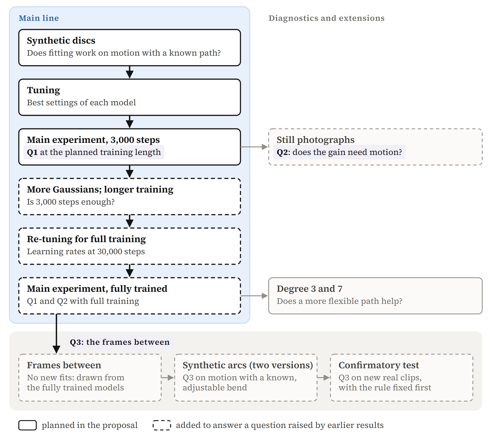

**Figure 2.** The experiments in the order they were run. The main line (blue lane) runs from top to bottom; grey boxes on the right are diagnostics and extensions that branch off the step they follow, and the grey lane below holds the three steps of Q3, which follow the fully trained main experiment. Each box gives the step and the question it answers. A solid border marks a step planned in the proposal, and a dashed border a step added to answer a question raised by earlier results. Degree 3 and 7 is drawn solid: the proposal planned it as a supplementary extension (Section 3.1), and it was run in a smaller form (Appendix B.4).

---

## 5 Results and analysis

The results are grouped by research question: reconstruction efficiency (Q1, Section 5.1), the attribution of the gains (Q2, Section 5.2) and temporal interpolation (Q3, Section 5.3). Full tables are in Appendices B to D.

### 5.1 Reconstruction efficiency under equal storage

#### 5.1.1 Results at the planned training length

The main experiment ran every combination of 4 models, 4 budgets, 4 clips, 2 strides and 3 seeds, plus a 30-frame Jockey clip, with the 3,000 training steps planned in the proposal.

Shrinking helps on every clip, by 0.5 to 2.3 dB, and passes the test; M3 helps the most and passes too. The curved path fails (Table 4). These results hold at the planned training length; Section 5.1.2 shows how they change with full training. Per-budget results, stride 1, SSIM and VMAF, the 30-frame clip and the costs are in Appendix B (B.1 and B.5).

#### 5.1.2 Results after extended training

A probe with more Gaussians showed two warning signs. Every model was still improving at step 3,000, and M3's lead over M0 kept shrinking during training, for example from +1.40 dB at step 500 to +0.57 dB at step 3,000. That raised the question of whether folding gives a better final picture or only learns faster. Jockey was then trained for 30,000 steps: every model needs 18,000 to 24,000 steps before its PSNR settles within 0.1 dB of its final value, and M0 alone gains 2 to 4 dB from the longer training, more than any ability ever added. The learning rates were re-tuned for 30,000 steps, and the main comparison was re-run at stride 3 with full training (192 fits). The record of these checks is in Appendix B.3.

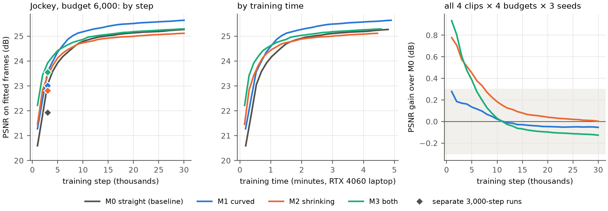

**Figure 3.** Left and middle: Jockey at budget 6,000, PSNR by training step and by training time (mean of 3 seeds). Right: gain over M0 at each step, averaged over all clips, budgets and seeds. Each ability starts ahead, and by about 10,000 steps all three are inside ±0.3 dB (grey band). A 30,000-step run lowers its learning rate more slowly, so its PSNR at step 3,000 differs from that of a separate 3,000-step run (diamonds).

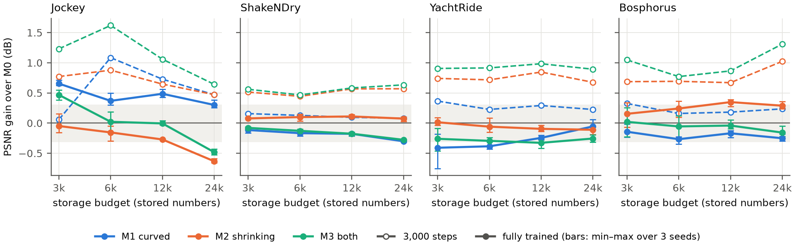

**Figure 4.** Gain over M0 against storage. Dashed lines with hollow markers are the 3,000-step fits; solid lines are the fully trained ones, with the seed range. The grey band is ±0.3 dB, the margin of the test of Section 3.3. After full training most gains fall inside the band, and some fall below zero.

After 3,000 steps, M2 and M3 led in all 16 cells by 0.44 to 1.62 dB. Fully trained, most cells are within ±0.3 dB, some above zero and some below, and all three abilities fail the test (Table 4). The seeds usually agree within 0.1 to 0.2 dB, so the small differences that remain are consistent across the 3 seeds tested; 3 seeds are too few to establish that they are statistically significant. M3 leads almost nowhere. SSIM differences stay within ±0.02, and VMAF points the same way as PSNR but varies by 2 to 4 points between seeds.

**Table 4.** The test fixed in the proposal (Section 3.3), after 3,000 steps and fully trained: at how many of the 4 budgets each model beats M0 by more than 0.3 dB and more than the seed spread. It needs 3 of 4 on both clips. The budget-by-budget values and judgements are in Tables A5 and A8; the judgements use the unrounded values.

| Model | 3,000 steps: Jockey | 3,000 steps: ShakeNDry | 3,000 steps: Verdict | Fully trained: Jockey | Fully trained: ShakeNDry | Fully trained: Verdict |
|---|:---:|:---:|:---:|:---:|:---:|:---:|
| M1 curved | 3 of 4 | 0 of 4 | fails | 4 of 4 | 0 of 4 | fails |
| M2 shrinking | 4 of 4 | 4 of 4 | **passes** | 0 of 4 | 0 of 4 | fails |
| M3 both | 4 of 4 | 4 of 4 | **passes** | 1 of 4 | 0 of 4 | fails |

**Higher-degree trajectories.** Each degree above 2 costs 2 more numbers per Gaussian, so at budget 24,000 a degree-7 model (D7) has only 1,000 Gaussians against M0's 2,000. D3 and D7 were fitted on Jockey and ShakeNDry at stride 3, budgets 6,000 and 24,000, with 3 seeds and full training. D3 is worse than M1 in 7 of 8 cells, and D7 is worse everywhere, by 1.1 to 2.3 dB on the fitted frames. The learning rate of the higher terms was not tuned; they reuse M1's acceleration rate. The full results and caveats, including the frames between, are in Appendix B.4.

### 5.2 Attribution of reconstruction gains

#### 5.2.1 Dependence on motion and spatial region

After 3,000 steps (Section 5.1.1), on ShakeNDry, the most curved clip, M1 gains only about 0.1 dB, less than on the two straight boat clips (+0.23 to +0.28 dB). On Jockey most of M1's gain is in the background (at stride 3, +0.15 dB on the horse and +0.66 dB off it). The dog is the only place where M1 gains more on the object than off it, and there the gain is small. By the second rule of the test (Section 3.4), then, M1's gain probably does not come from curved motion.

Fully trained (Section 5.1.2), the small differences that remain do not follow the motion. M1 leads only on Jockey, and mostly in the background (+0.33 to +0.69 dB, against +0.21 to +0.50 dB on the horse). M2 leads only on Bosphorus, the straightest clip, again in the background. The object-versus-background tables are in Appendix C.1.

#### 5.2.2 Static-image control

If shrinking helped because it handles motion, it should not help when nothing moves. The first frame of each clip was copied 10 times to make still videos, which were fitted with exactly the same settings.

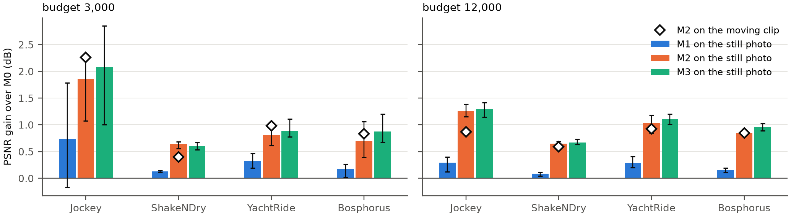

**Figure 5.** Gain over M0 on still photographs after 3,000 steps (bars show the mean, lines the range over 3 seeds). The diamond marks M2's gain on the same clip in motion. Shrinking gains about as much on a still photo as on the video.

On a still photo, M2 beats M0 by 0.6 to 1.9 dB, close to its 0.4 to 2.3 dB on the moving clips, on all 4 photos and all 3 seeds. The curved path also gains about the same with and without motion; on ShakeNDry it is +0.09 dB in motion and +0.09 to +0.13 dB still. Both gains appear without motion, so they cannot be attributed to motion modeling alone. The still photographs were fitted for 3,000 steps only, so this control concerns the gains at the planned training length. The full results are in Appendix C.1.

#### 5.2.3 Learned Gaussian motion and interpretation

The accelerations that M1's Gaussians learned were also compared with the motion that optical flow measures at each Gaussian's centre. Almost every Gaussian curves: over its life, its acceleration moves it 12 to 35 pixels off a straight line (median). On a nearly still background the learned acceleration is more than 10 times the real one, and its direction matches the real motion about half the time, which is what chance gives. Velocity behaves the same way. The diagnostic tables, and the checks of lifetimes and of where shrinking helps, are in Appendices C.2 and C.3.

The reading here is that with few Gaussians, letting each one change over time lets it do the work of several, at different places or sizes in different frames. This helps whether or not anything moves. Section 5.1.2 shows the same pattern over training: each ability starts ahead and its lead fades, which by the rule fixed before the 10,000-step run (Appendix B.3) counts as faster learning.

### 5.3 Temporal interpolation

As noted in Section 3.5, this analysis was added after the main results.

#### 5.3.1 Real-video interpolation

At stride 3, a model is fitted to frames 0, 3, 6, … and never sees frames 1, 2, 4, 5, …; its Gaussians can still be drawn at those times. An exploratory look at the fully trained models found that on the shaking dog, M1 and M3 drew these frames between 0.2 and 0.5 dB better than M0, while on the fitted frames they were level. This was found after looking at the data, and it covered a small region (Appendix D.3).

To test it, a rule was fixed before running anything else and applied to three real clips not used before: ShakeNDry from frame 30, where the dog is still shaking, and Jockey from frames 120 and 200, where the horse is galloping. M0 and M1 were fitted at strides 3 and 5 and budgets 6,000 and 24,000, with 3 seeds and full training. Only the moving object in the frames between is scored. A cell passes if M1 beats M0 for all 3 seeds, and with 9 or more of the 12 cells passing, the curved path counts as a real gain for the frames between. It was also predicted that the gain would be larger at stride 5 than at stride 3. The full rule is in Appendix D.1.

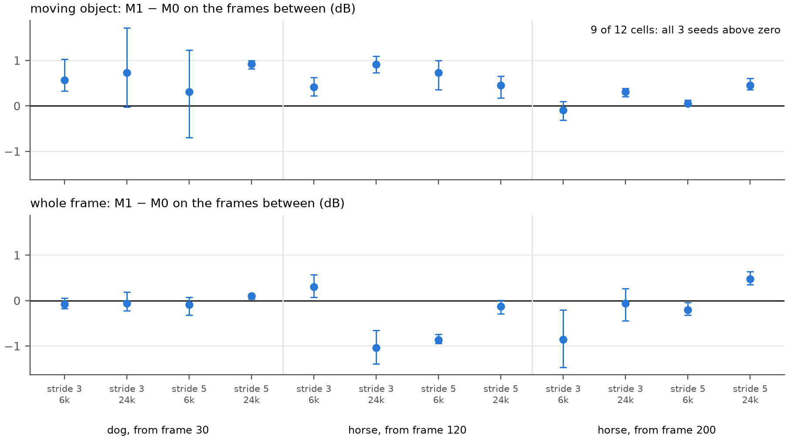

**Figure 6.** The confirmatory test: M1 − M0 on the frames between, on the moving object (top) and over the whole frame (bottom), on the same scale, for the 12 cells (3 clips × 2 strides × 2 budgets). Dots are the mean of 3 seeds; bars show the range from the lowest to the highest seed, not a confidence interval. On the moving object, green cells have all 3 seeds above zero (9 of the 12) and red open cells do not; the whole frame (grey) is not part of the test.

On the moving object, M1 draws the frames between about 0.5 dB better than M0 on average; the cell means range from −0.1 to +0.9 dB, and 11 of the 12 are positive. In 9 of the 12 cells all three seeds are positive, which meets the threshold of 9 fixed in advance. Over the whole frame there is no consistent gain (−1.04 to +0.48 dB): M1 draws the horse and the dog a little better between frames and the moving background a little worse, so under the proposal's rule the gain is local. The fitted frames show no gain either (Section 5.1.2). The predicted larger gain at stride 5 did not appear (+0.49 dB at stride 5 against +0.47 dB at stride 3).

The paths of the Gaussians give no direct support for this gain: on the dog, M1's Gaussians bend the right way about as often as chance, and their path errors are as large as the error of the optical-flow measurement (Appendix D.3). Because flow tracking limits this check, the controlled test of Section 5.3.2 uses a clip whose path is known.

#### 5.3.2 Controlled motion test

Synthetic clips show a striped ball moving at a fixed speed over a still background. Its path is an arc that turns by 0°, 90°, 180°, 270° or 360° over the clip, and nothing else changes between the clips. Figure 7 shows each clip at two fitted frames and at one frame between them. M0 and M1 were fitted at budgets 6,000 and 24,000, with 3 seeds and full training. The predictions were written down before running; they and their outcome are in Appendix D.2.

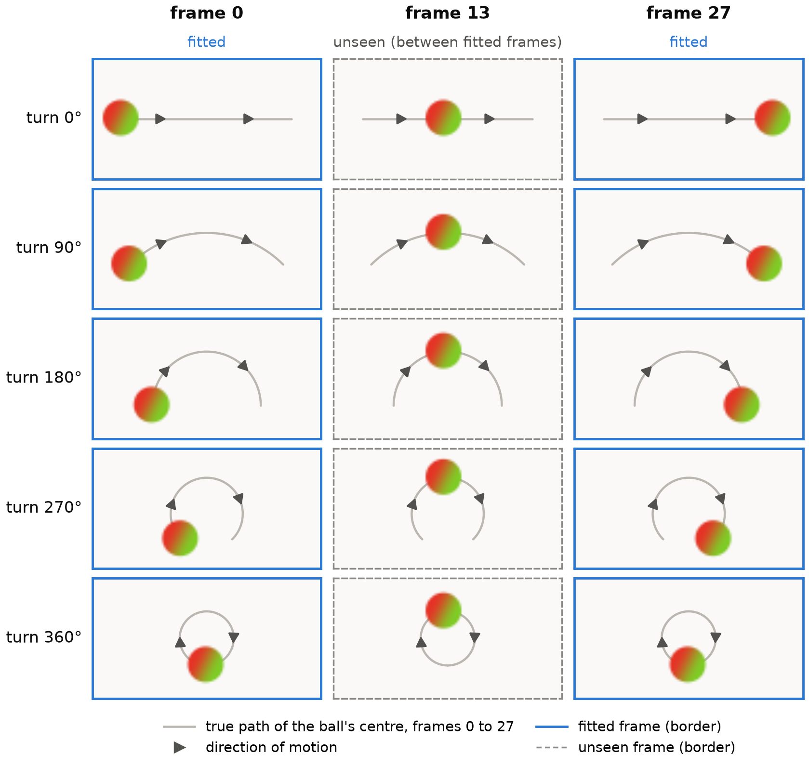

**Figure 7.** The five synthetic clips, one per row, whose paths turn by 0°, 90°, 180°, 270° and 360° over the clip, at frames 0, 13 and 27. At stride 3 the models are fitted to frames 0, 3, …, 27, so frames 0 and 27 are fitted frames (solid blue border) and frame 13 lies between them and is never fitted (dashed border). The ball is drawn from the pixels of the generated clips, shown over a light background instead of the clips' own. The grey line is the true path of the ball's centre over frames 0 to 27, and the arrows give the direction of motion along it; on the full turn the ball is back at its starting point at frame 27. In every clip the ball (radius 8 pixels) moves at the same speed, 3 pixels per frame, and nothing else changes; all panels share the same pixel scale. An animated version is at [docs/figures/arc_motion.gif](docs/figures/arc_motion.gif).

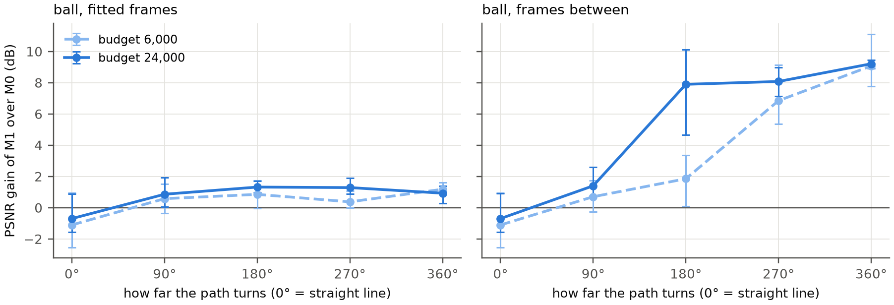

**Figure 8.** M1 against M0 on the ball, by how far the path turns, with the seed range. On the fitted frames (left) the gain stays near 1 dB at every bend. On the frames between (right) it rises from about 0 on a straight line to about 9 dB for a full turn.

On the frames between, the gain grows with the bend at both budgets: M1 is slightly behind on the straight line (it has 14% fewer Gaussians, and the seed ranges cross zero), and at a full turn even the worst seed gains 7.8 or 8.9 dB. On the fitted frames the gain stays near 1 dB whatever the bend, because the straight model passes the arc from one short Gaussian to the next and still fits every fitted frame. M1's Gaussians on the ball bend the right way 91% to 100% of the time, and their acceleration is close to the true one.

Within the experiments of this project, the synthetic test with known motion supports a motion-based mechanism for the curved path, and its clear gains appear mainly on the unseen frames between. The reconstruction test of Q1 scores only the fitted frames, so it does not measure these gains. With a known, strongly bending path the gain is large; on the real clips it is small (about 0.5 dB on the moving object) and does not reach the whole frame.

This is the second version of the test; the first version and the precondition added before the second are described in Appendix D.2.

---

## 6 Conclusion

The three research questions are answered as follows.

> **Q1.** *Under a fixed storage budget, does Gaussian folding provide a net benefit in reconstruction quality over linear space-time baselines?*
>
> **Answer.** For the clips, budgets and settings tested here, folding does not give a lasting gain in reconstruction efficiency at equal storage. After the planned 3,000 steps, shrinking (M2) and both abilities together (M3) beat the straight-line baseline by 0.5 to 2.3 dB and pass the test fixed in the proposal, while the curved path (M1) does not. With full training the baseline catches up. No ability keeps a steady whole-frame gain on the fitted frames, and all three fail the test.

> **Q2.** *If trajectory folding yields performance gains, are these improvements driven specifically by superior motion modeling?*
>
> **Answer.** The evidence does not support attributing the early gains mainly to the recovery of real motion; it is more consistent with faster optimization. Similar gains appear on still photographs, the learned accelerations do not consistently follow the real motion, the few leads left after full training sit in the background, and the early leads shrink as training continues. Within a short, fixed number of training steps, shrinking therefore does give a better picture.

> **Q3.** *Does non-linear trajectory modeling improve reconstruction accuracy on unseen intermediate frames (video frame interpolation)?*
>
> **Answer.** A curved path improves the frames between, with stronger evidence on synthetic motion than on real video. On synthetic arcs with known motion, the gain on the frames between grows with the bend, up to about 9 dB, and the learned Gaussians bend with the known motion, which supports a motion-based mechanism in that setting. On new real clips, the moving object is drawn about 0.5 dB better on average in the unseen frames between, which meets the threshold fixed before the test. The whole frame does not improve consistently, and the path diagnostics on the real clips do not directly confirm the same mechanism. This is a local interpolation gain, separate from the reconstruction efficiency addressed in Q1.

---

## 7 Limitations and AI use

### Limitations

**Scope of evaluation.** The models were compared with 250 to 2,000 Gaussians per 10-frame clip (at most 0.015 per pixel, against about 0.65 for VeGaS), on short, small (480×270) clips from 4 UVG sequences. A probe with up to 64,000 Gaussians ran only for 3,000 steps (Table A10), and no fully trained comparison was run at that capacity. The conclusions apply to the clips, budgets and resolution tested and do not extend directly to larger models, higher resolutions or other videos.

**Optimization coverage.** Settings were selected on one Jockey validation clip (Section 4.3) and checked on one ShakeNDry clip. For full training the velocity learning rate was re-tuned, while the acceleration ratio and $s_{\min}$ kept their 3,000-step values; the higher-degree terms reuse M1's acceleration rate. Each model is compared at the best setting found in the tested range, which need not be its optimum, and the D3 and D7 results reflect their narrower tuning.

**Motion attribution and generalization.** The object outlines come from Mask R-CNN and were checked by eye. The optical flow has 3 to 6 pixels of error, so the path diagnostics cannot settle whether Gaussians on real clips follow the physical motion; their lack of direct support does not show that no motion was learned. Bosphorus is both straight and slow, and the two cannot be separated on it. The real-video gain on the frames between, found in an exploratory analysis and confirmed on three new clips under a rule fixed beforehand, is small and local; it does not show that the Gaussians recover accurate physical motion, or that the gain holds for a broad range of videos.

The changes from the plan in the proposal are recorded in Appendix A.5.

### AI use

Claude (Anthropic) was used to discuss the experimental design, write and check code, run and analyse experiments, and draft the text and figures of the project website and of this report. Decisions on the research questions, the models, the clips, the budgets, the tests and the conclusions were made and checked by the author.

---

## Appendix

The appendix has four groups: A covers the setup and reproducibility of the experiments, and B to D hold the full material for Q1 to Q3 (Sections 5.1 to 5.3). Unless stated otherwise, a gain is the difference from M0 in dB, paired by seed; a positive value means a higher PSNR than M0. The references follow the appendix.

### A. Experimental setup and reproducibility

This group describes how the results can be reproduced, how the motion of the clips was measured, how the settings were chosen, and which experiments were run (Sections 3 and 4).

#### A.1 Reproduction commands

All code is in `stg/`; the course program `gaussian_image_video.py` is unchanged. `stg/sweep.py` lists every experiment, and an experiment resumes where it stopped.

```
python -m stg.check --device cuda                          # gradient checks                (4.1)
python -m stg.sweep --stage test --all --device cuda       # main experiment, 3,000 steps   (5.1.1)
python -m stg.sweep --stage still --all --device cuda      # still photographs              (5.2.2)
python -m stg.sweep --stage long_test --all --device cuda  # main experiment, fully trained (5.1.2)
python -m stg.sweep --stage poly --all --device cuda       # degree 3 and 7                 (5.1.2)
python -m stg.unseen runs/long_test                        # frames between                 (5.3.1)
python -m stg.sweep --stage arc_slow --all --device cuda   # synthetic arcs                 (5.3.2)
python -m stg.sweep --stage confirm --all --device cuda    # confirmatory test              (5.3.1)
python -m stg.export_site                                  # data of the project website
python -m stg.appendix_tables                              # appendix tables and CSV files
python -m stg.figures --crops                              # figures and tables
```

Data: [`fits.csv`](docs/data/csv/fits.csv) (every one of the 1,496 fits, per seed: its settings, PSNR, SSIM and VMAF on the fitted frames, PSNR on the object, the background and the frames between, and its timing). The tables of Appendices B to D and their CSV files are computed from it. The same fits, with the PSNR of each fit during training, are in [`runs.json`](docs/data/runs.json) (2.1 MB), the file read by the scripts above.

#### A.2 Data and motion measurements

Table A2 gives the optical flow measurement of Section 3.2. Acceleration increases by 3 to 7 times at stride 3. ShakeNDry has the highest bend at both strides.

**Table A2.** Motion of the test clips over the whole frame, camera motion included (pixels per frame, and per frame²).

| Clip | Stride | Speed | Acceleration | Bend |
|---|---:|---:|---:|---:|
| Jockey | 1 | 3.09 | 0.15 | 0.05 |
| Jockey | 3 | 7.69 | 1.12 | 0.15 |
| ShakeNDry | 1 | 0.20 | 0.17 | 0.84 |
| ShakeNDry | 3 | 0.41 | 0.55 | 1.35 |
| YachtRide | 1 | 1.17 | 0.17 | 0.14 |
| YachtRide | 3 | 3.07 | 0.64 | 0.21 |
| Bosphorus | 1 | 0.40 | 0.04 | — |
| Bosphorus | 3 | 1.29 | 0.09 | — |

#### A.3 Hyperparameter selection

The settings for the 3,000-step experiments were chosen on the validation clip as described in Section 4.3, with the results in Table A1. For full training, the velocity learning rate was chosen again on the same clip, after the checks of training length in Appendix B.3.

**Table A3.** The velocity learning rate re-tuned for 30,000 steps on the validation clip (Jockey from frame 60, stride 3, seed 0): PSNR at each rate, the chosen rate, and the gap to M0 at the chosen rates.

| Model | Budget | PSNR at velocity rate 0.05 (dB) | PSNR at 0.1 (dB) | PSNR at 0.2 (dB) | Chosen rate | Gap to M0 (dB) |
|---|---:|---:|---:|---:|---:|---:|
| M0 | 6,000 | 25.79 | 25.74 | 25.82 | 0.2 | — |
| M0 | 24,000 | 29.13 | 29.15 | 29.32 | 0.2 | — |
| M1 | 6,000 | 25.63 | 25.64 | 25.68 | 0.05 | −0.19 |
| M1 | 24,000 | 28.95 | 28.80 | 28.82 | 0.05 | −0.37 |
| M2 | 6,000 | 25.60 | 25.74 | 25.55 | 0.1 | −0.08 |
| M2 | 24,000 | 28.40 | 28.67 | 28.55 | 0.1 | −0.65 |
| M3 | 6,000 | 25.67 | 25.47 | 25.60 | 0.2 | −0.22 |
| M3 | 24,000 | 28.16 | 28.26 | 28.36 | 0.2 | −0.96 |

The learning rate moves the result by about 0.1 dB with no pattern, far less than the gaps between models. These rates were checked on another clip (ShakeNDry from frame 100, budget 6,000): the two rates tried per model differ by only 0.02 to 0.05 dB, so the rates chosen on Jockey carry over.

#### A.4 Record of experiments

**Table A4.** The experiments in the order they were run. The first three were planned in the proposal; each later one answers a question raised by the results before it. Section 5 groups the results by research question; the last column gives where each experiment is reported.

| Experiment | What it answers | Fits | Training steps | Results |
|---|---|---:|---:|---|
| Synthetic discs | Does fitting work on motion with a known path? | 48 | 3,000 | 4.2 |
| Tuning | Best settings of each model | 448 | 3,000 | 4.3 |
| Main experiment | Q1 at the planned training length | 432 | 3,000 | 5.1.1 |
| Still photographs | Q2: does the gain need motion? | 96 | 3,000 | 5.2.2 |
| More Gaussians; longer training | Is 3,000 steps enough? | 32 | 3,000 to 30,000 | 5.1.2 |
| Re-tuning for full training | Learning rates at 30,000 steps | 32 | 30,000 | 5.1.2 |
| Main experiment, fully trained | Q1 and Q2 with full training | 192 | 30,000 | 5.1.2 |
| Degree 3 and 7 | Does a more flexible path help? | 24 | 30,000 | 5.1.2 |
| Synthetic arcs (two versions) | Q3 on motion with a known, adjustable bend | 120 | 30,000 | 5.3.2 |
| Confirmatory test | Q3 on new real clips, with the rule fixed first | 72 | 30,000 | 5.3.1 |
| **Total** | | **1,496** | | about 68 hours |

#### A.5 Changes from the proposal

How the experiments differ from the plan in the proposal. The experiments themselves, in the order they were run, are in Table A4.

**Changes to the method**

- Bosphorus was added as a fourth clip after measuring the motion, because YachtRide's waves are not straight (Section 3.2).
- The velocity learning rate was tuned for every model, the baseline included, after the synthetic test showed that M1's gain depended on it (Section 4.2).
- The object outlines were made with Mask R-CNN instead of hand-drawn horse masks and flow masks; flow masks worked only on the still-camera clip (Section 4.4).

**Added tests**

- Full training (30,000 steps) was added after 3,000 steps was found to be far too short. The 3,000-step results are reported as a comparison at equal training steps (Section 5.1).
- The synthetic arcs and the confirmatory test were added to answer Q3, after the main results (Section 3.5). The dog result that led to the confirmatory test was found after looking at the data; Q3 is treated as supplementary, and a separate rule was fixed before the confirmatory runs (Section 5.3.1).

**Reduced or not run**

- The degree extension was run on 2 clips and 2 budgets of 10 frames, not on the 30-frame clip.
- Stride 2, HoneyBee, and a fully trained run with many Gaussians (1 to 2 hours per fit) were not run. A probe with up to 64,000 Gaussians was run for 3,000 steps only, where M3 stayed ahead by 0.4 to 0.8 dB (Table A10).

### B. Reconstruction efficiency (Q1)

This group gives the full results for Section 5.1, after 3,000 steps and fully trained, with the checks of training length, the higher-degree paths, the longer clip and the cost.

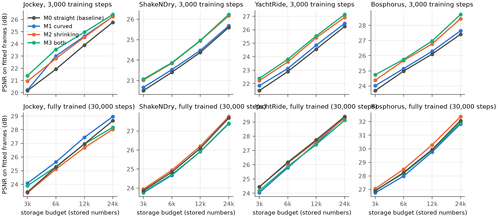

**Figure A1.** PSNR on the fitted frames against storage, at stride 3 (mean of 3 seeds). After 3,000 steps (top row), M3 and M2 lie above the baseline on every clip. Fully trained (bottom row, Section 5.1.2), the four lines nearly meet.

#### B.1 Results after 3,000 steps

The test of Section 3.3 at each budget comes first (Table A5), then the gains on all four clips at both strides (Table A6), and the SSIM and VMAF gains (Table A7).

**Table A5.** The test of Section 3.3 after 3,000 steps, at stride 3, one row per clip, model and budget. ΔPSNR is the gain over M0 on the fitted frames (mean of 3 seeds). The seed spread is the difference between the highest and lowest PSNR over the 3 seeds, taking the larger of M0 and the model compared (Section 4.4). A budget meets the criterion when ΔPSNR is more than 0.3 dB and more than the seed spread. The judgement uses the unrounded values in the CSV file; where two decimals would place a value on the wrong side of a threshold, three decimals are shown.

| Clip | Model | Budget | ΔPSNR (dB) | Seed spread (dB) | Meets criterion |
|---|---|---:|---:|---:|---|
| Jockey | M1 curved | 3,000 | +0.06 | 0.39 | No |
| Jockey | M1 curved | 6,000 | +1.09 | 0.35 | Yes |
| Jockey | M1 curved | 12,000 | +0.73 | 0.44 | Yes |
| Jockey | M1 curved | 24,000 | +0.47 | 0.37 | Yes |
| Jockey | M2 shrinking | 3,000 | +0.77 | 0.21 | Yes |
| Jockey | M2 shrinking | 6,000 | +0.88 | 0.34 | Yes |
| Jockey | M2 shrinking | 12,000 | +0.65 | 0.22 | Yes |
| Jockey | M2 shrinking | 24,000 | +0.47 | 0.16 | Yes |
| Jockey | M3 both | 3,000 | +1.23 | 0.52 | Yes |
| Jockey | M3 both | 6,000 | +1.62 | 0.34 | Yes |
| Jockey | M3 both | 12,000 | +1.06 | 0.21 | Yes |
| Jockey | M3 both | 24,000 | +0.64 | 0.12 | Yes |
| ShakeNDry | M1 curved | 3,000 | +0.16 | 0.13 | No |
| ShakeNDry | M1 curved | 6,000 | +0.13 | 0.10 | No |
| ShakeNDry | M1 curved | 12,000 | +0.10 | 0.08 | No |
| ShakeNDry | M1 curved | 24,000 | +0.08 | 0.09 | No |
| ShakeNDry | M2 shrinking | 3,000 | +0.51 | 0.13 | Yes |
| ShakeNDry | M2 shrinking | 6,000 | +0.44 | 0.12 | Yes |
| ShakeNDry | M2 shrinking | 12,000 | +0.57 | 0.08 | Yes |
| ShakeNDry | M2 shrinking | 24,000 | +0.57 | 0.09 | Yes |
| ShakeNDry | M3 both | 3,000 | +0.56 | 0.13 | Yes |
| ShakeNDry | M3 both | 6,000 | +0.47 | 0.10 | Yes |
| ShakeNDry | M3 both | 12,000 | +0.58 | 0.08 | Yes |
| ShakeNDry | M3 both | 24,000 | +0.63 | 0.09 | Yes |

The number of budgets meeting the criterion for each clip and model is given below. A model passes with 3 or more of the 4 budgets on both clips; the verdicts are in Table 4.

| Clip | M1 curved | M2 shrinking | M3 both |
|---|---:|---:|---:|
| Jockey | 3 of 4 | 4 of 4 | 4 of 4 |
| ShakeNDry | 0 of 4 | 4 of 4 | 4 of 4 |

**Table A6.** Gain over M0 after 3,000 steps by clip and stride (dB), mean over the 4 budgets and 3 seeds.

| Clip | Stride | M1 curved | M2 shrinking | M3 both |
|---|---:|---:|---:|---:|
| Jockey | 1 | +0.35 | +1.35 | +1.46 |
| Jockey | 3 | +0.59 | +0.69 | +1.14 |
| ShakeNDry | 1 | +0.09 | +0.51 | +0.55 |
| ShakeNDry | 3 | +0.12 | +0.52 | +0.56 |
| YachtRide | 1 | +0.23 | +1.03 | +1.06 |
| YachtRide | 3 | +0.28 | +0.75 | +0.92 |
| Bosphorus | 1 | +0.24 | +0.88 | +1.02 |
| Bosphorus | 3 | +0.23 | +0.77 | +1.00 |

**Table A7.** SSIM and VMAF gains over M0 after 3,000 steps, mean over the 4 budgets and 3 seeds. SSIM is on a scale of 0 to 1 and VMAF on a scale of 0 to 100. They rank the models in the same order as PSNR (M3, M2, M1, M0), so the PSNR gain shows up in structure as well.

| Clip | Stride | Model | SSIM gain | VMAF gain |
|---|---:|---|---:|---:|
| Jockey | 1 | M1 curved | +0.01 | +1.1 |
| Jockey | 1 | M2 shrinking | +0.04 | +6.2 |
| Jockey | 1 | M3 both | +0.05 | +6.4 |
| Jockey | 3 | M1 curved | +0.02 | +3.3 |
| Jockey | 3 | M2 shrinking | +0.02 | +2.3 |
| Jockey | 3 | M3 both | +0.04 | +5.9 |
| ShakeNDry | 1 | M1 curved | +0.01 | +0.3 |
| ShakeNDry | 1 | M2 shrinking | +0.03 | +0.6 |
| ShakeNDry | 1 | M3 both | +0.04 | +1.0 |
| ShakeNDry | 3 | M1 curved | +0.01 | +0.3 |
| ShakeNDry | 3 | M2 shrinking | +0.03 | +0.7 |
| ShakeNDry | 3 | M3 both | +0.03 | +0.8 |
| YachtRide | 1 | M1 curved | +0.01 | +1.0 |
| YachtRide | 1 | M2 shrinking | +0.03 | +4.3 |
| YachtRide | 1 | M3 both | +0.04 | +4.9 |
| YachtRide | 3 | M1 curved | +0.01 | +1.1 |
| YachtRide | 3 | M2 shrinking | +0.03 | +2.7 |
| YachtRide | 3 | M3 both | +0.03 | +3.4 |
| Bosphorus | 1 | M1 curved | +0.01 | +0.3 |
| Bosphorus | 1 | M2 shrinking | +0.03 | +1.7 |
| Bosphorus | 1 | M3 both | +0.04 | +2.3 |
| Bosphorus | 3 | M1 curved | +0.01 | +0.6 |
| Bosphorus | 3 | M2 shrinking | +0.03 | +2.0 |
| Bosphorus | 3 | M3 both | +0.04 | +3.2 |

Data: [`gains_3000_steps.csv`](docs/data/csv/gains_3000_steps.csv) (every clip, stride, budget and model after 3,000 steps: the mean, lowest and highest gain over the seeds, the seed spread, the test, and the object, background, SSIM and VMAF gains).

#### B.2 Results after full training

The same test when fully trained (Table A8), then the gain in every clip and budget with its seed range (Table A9).

**Table A8.** The test of Section 3.3 when fully trained, at stride 3, laid out as Table A5, with the seed spread of these fits. The judgement uses the unrounded values in the CSV file; where two decimals would place a value on the wrong side of a threshold, three decimals are shown. At budget 24,000 on Jockey, M1's gain is 0.30147 dB: it appears as +0.30 in Tables A9 and A12 and meets the 0.3 dB margin.

| Clip | Model | Budget | ΔPSNR (dB) | Seed spread (dB) | Meets criterion |
|---|---|---:|---:|---:|---|
| Jockey | M1 curved | 3,000 | +0.65 | 0.23 | Yes |
| Jockey | M1 curved | 6,000 | +0.37 | 0.16 | Yes |
| Jockey | M1 curved | 12,000 | +0.49 | 0.10 | Yes |
| Jockey | M1 curved | 24,000 | +0.301 | 0.124 | Yes |
| Jockey | M2 shrinking | 3,000 | −0.05 | 0.48 | No |
| Jockey | M2 shrinking | 6,000 | −0.15 | 0.14 | No |
| Jockey | M2 shrinking | 12,000 | −0.27 | 0.04 | No |
| Jockey | M2 shrinking | 24,000 | −0.63 | 0.12 | No |
| Jockey | M3 both | 3,000 | +0.47 | 0.23 | Yes |
| Jockey | M3 both | 6,000 | +0.02 | 0.29 | No |
| Jockey | M3 both | 12,000 | −0.00 | 0.11 | No |
| Jockey | M3 both | 24,000 | −0.48 | 0.12 | No |
| ShakeNDry | M1 curved | 3,000 | −0.11 | 0.07 | No |
| ShakeNDry | M1 curved | 6,000 | −0.17 | 0.08 | No |
| ShakeNDry | M1 curved | 12,000 | −0.18 | 0.08 | No |
| ShakeNDry | M1 curved | 24,000 | −0.30 | 0.04 | No |
| ShakeNDry | M2 shrinking | 3,000 | +0.08 | 0.03 | No |
| ShakeNDry | M2 shrinking | 6,000 | +0.10 | 0.08 | No |
| ShakeNDry | M2 shrinking | 12,000 | +0.11 | 0.08 | No |
| ShakeNDry | M2 shrinking | 24,000 | +0.08 | 0.08 | No |
| ShakeNDry | M3 both | 3,000 | −0.08 | 0.04 | No |
| ShakeNDry | M3 both | 6,000 | −0.13 | 0.08 | No |
| ShakeNDry | M3 both | 12,000 | −0.18 | 0.08 | No |
| ShakeNDry | M3 both | 24,000 | −0.28 | 0.02 | No |

Budgets meeting the criterion, of 4 (verdicts in Table 4):

| Clip | M1 curved | M2 shrinking | M3 both |
|---|---:|---:|---:|
| Jockey | 4 of 4 | 0 of 4 | 1 of 4 |
| ShakeNDry | 0 of 4 | 0 of 4 | 0 of 4 |

**Table A9.** Gain over M0 when fully trained (stride 3), by clip, budget and model: mean, lowest and highest over 3 seeds (dB, paired by seed). M0 PSNR is the baseline's PSNR on the fitted frames (mean of 3 seeds) and is the same for the three model rows of a budget. The gains after 3,000 steps at each budget are in `gains_3000_steps.csv`.

| Clip | Budget | M0 PSNR (dB) | Model | Mean | Lowest | Highest |
|---|---:|---:|---|---:|---:|---:|
| Jockey | 3,000 | 23.43 | M1 curved | +0.65 | +0.62 | +0.71 |
| Jockey | 3,000 | 23.43 | M2 shrinking | −0.05 | −0.16 | +0.15 |
| Jockey | 3,000 | 23.43 | M3 both | +0.47 | +0.38 | +0.55 |
| Jockey | 6,000 | 25.27 | M1 curved | +0.37 | +0.30 | +0.50 |
| Jockey | 6,000 | 25.27 | M2 shrinking | −0.15 | −0.29 | −0.05 |
| Jockey | 6,000 | 25.27 | M3 both | +0.02 | −0.15 | +0.18 |
| Jockey | 12,000 | 26.96 | M1 curved | +0.49 | +0.43 | +0.56 |
| Jockey | 12,000 | 26.96 | M2 shrinking | −0.27 | −0.28 | −0.26 |
| Jockey | 12,000 | 26.96 | M3 both | −0.00 | −0.03 | +0.04 |
| Jockey | 24,000 | 28.66 | M1 curved | +0.30 | +0.26 | +0.39 |
| Jockey | 24,000 | 28.66 | M2 shrinking | −0.63 | −0.66 | −0.59 |
| Jockey | 24,000 | 28.66 | M3 both | −0.48 | −0.53 | −0.43 |
| ShakeNDry | 3,000 | 23.87 | M1 curved | −0.11 | −0.17 | −0.09 |
| ShakeNDry | 3,000 | 23.87 | M2 shrinking | +0.08 | +0.07 | +0.09 |
| ShakeNDry | 3,000 | 23.87 | M3 both | −0.08 | −0.10 | −0.06 |
| ShakeNDry | 6,000 | 24.84 | M1 curved | −0.17 | −0.21 | −0.12 |
| ShakeNDry | 6,000 | 24.84 | M2 shrinking | +0.10 | +0.03 | +0.15 |
| ShakeNDry | 6,000 | 24.84 | M3 both | −0.13 | −0.16 | −0.10 |
| ShakeNDry | 12,000 | 26.09 | M1 curved | −0.18 | −0.21 | −0.15 |
| ShakeNDry | 12,000 | 26.09 | M2 shrinking | +0.11 | +0.09 | +0.14 |
| ShakeNDry | 12,000 | 26.09 | M3 both | −0.18 | −0.20 | −0.15 |
| ShakeNDry | 24,000 | 27.68 | M1 curved | −0.30 | −0.31 | −0.29 |
| ShakeNDry | 24,000 | 27.68 | M2 shrinking | +0.08 | +0.03 | +0.10 |
| ShakeNDry | 24,000 | 27.68 | M3 both | −0.28 | −0.28 | −0.27 |
| YachtRide | 3,000 | 24.44 | M1 curved | −0.41 | −0.75 | −0.18 |
| YachtRide | 3,000 | 24.44 | M2 shrinking | +0.01 | −0.03 | +0.09 |
| YachtRide | 3,000 | 24.44 | M3 both | −0.26 | −0.46 | −0.09 |
| YachtRide | 6,000 | 26.18 | M1 curved | −0.38 | −0.43 | −0.31 |
| YachtRide | 6,000 | 26.18 | M2 shrinking | −0.06 | −0.15 | +0.08 |
| YachtRide | 6,000 | 26.18 | M3 both | −0.29 | −0.39 | −0.24 |
| YachtRide | 12,000 | 27.74 | M1 curved | −0.24 | −0.27 | −0.20 |
| YachtRide | 12,000 | 27.74 | M2 shrinking | −0.09 | −0.14 | −0.03 |
| YachtRide | 12,000 | 27.74 | M3 both | −0.33 | −0.42 | −0.28 |
| YachtRide | 24,000 | 29.38 | M1 curved | −0.05 | −0.11 | +0.06 |
| YachtRide | 24,000 | 29.38 | M2 shrinking | −0.11 | −0.19 | −0.06 |
| YachtRide | 24,000 | 29.38 | M3 both | −0.26 | −0.31 | −0.20 |
| Bosphorus | 3,000 | 26.90 | M1 curved | −0.14 | −0.24 | −0.02 |
| Bosphorus | 3,000 | 26.90 | M2 shrinking | +0.15 | −0.07 | +0.34 |
| Bosphorus | 3,000 | 26.90 | M3 both | +0.02 | −0.22 | +0.26 |
| Bosphorus | 6,000 | 28.25 | M1 curved | −0.27 | −0.34 | −0.23 |
| Bosphorus | 6,000 | 28.25 | M2 shrinking | +0.24 | +0.10 | +0.36 |
| Bosphorus | 6,000 | 28.25 | M3 both | −0.05 | −0.26 | +0.12 |
| Bosphorus | 12,000 | 29.94 | M1 curved | −0.17 | −0.24 | −0.13 |
| Bosphorus | 12,000 | 29.94 | M2 shrinking | +0.35 | +0.28 | +0.39 |
| Bosphorus | 12,000 | 29.94 | M3 both | −0.04 | −0.09 | +0.05 |
| Bosphorus | 24,000 | 32.08 | M1 curved | −0.25 | −0.29 | −0.18 |
| Bosphorus | 24,000 | 32.08 | M2 shrinking | +0.29 | +0.24 | +0.36 |
| Bosphorus | 24,000 | 32.08 | M3 both | −0.16 | −0.22 | −0.05 |

Data: [`gains_full_training.csv`](docs/data/csv/gains_full_training.csv) (every clip, budget and model when fully trained, with the seed range, the test, and the gains on the frames between).

#### B.3 Training convergence checks

These checks found that 3,000 steps is far from full training, and led to the fully trained comparison of Section 5.1.2.

**Table A10.** More Gaussians, 3,000 steps, Jockey stride 3, seed 0. M3's lead over M0 at step 500 and at step 3,000.

| Gaussians (M0) | M0 PSNR (dB) | M3 PSNR (dB) | M3 − M0, step 500 (dB) | M3 − M0, step 3,000 (dB) |
|---:|---:|---:|---:|---:|
| 4,000 | 27.61 | 28.18 | +1.40 | +0.57 |
| 8,000 | 29.70 | 30.10 | +1.45 | +0.40 |
| 16,000 | 32.32 | 32.71 | +1.37 | +0.39 |
| 32,000 | 35.38 | 35.93 | +1.68 | +0.55 |
| 64,000 | 38.89 | 39.67 | +2.17 | +0.78 |

Jockey (stride 3, seed 0) was then trained for 10,000 steps (Table A11). It had been decided beforehand that if less than half of the lead remained, the gain would count as faster learning. None of the abilities kept half.

**Table A11.** Gain over M0 after 3,000 and after 10,000 steps (dB).

| Budget | Steps | M0 PSNR (dB) | M1 | M2 | M3 |
|---:|---|---:|---:|---:|---:|
| 6,000 | 3,000 | 22.07 | +1.15 | +0.80 | +1.44 |
| 6,000 | 10,000 | 24.73 | +0.40 | −0.15 | +0.17 |
| 24,000 | 3,000 | 25.73 | +0.65 | +0.50 | +0.72 |
| 24,000 | 10,000 | 28.03 | +0.03 | −0.34 | −0.40 |
| 192,000 | 3,000 | 32.32 | — | — | +0.39 |
| 192,000 | 10,000 | 34.47 | — | — | −0.56 |

At 30,000 steps, every model had been within 0.1 dB of its final value since step 18,000 to 24,000, and the last 5,000 steps added only 0.03 to 0.08 dB. On that one test clip M1 kept about +0.4 dB, but this did not repeat on the validation clip (Table A3).

#### B.4 Higher-degree trajectories

Each degree above 2 costs 2 more numbers per Gaussian, so at budget 24,000 a degree-7 model (D7) has only 1,000 Gaussians against M0's 2,000. D3 and D7 were fitted on Jockey and ShakeNDry at stride 3, budgets 6,000 and 24,000, with 3 seeds and full training. For the terms above the square, time is measured in units of half a clip (4.5 frames), so that one training step cannot throw a Gaussian thousands of pixels away.

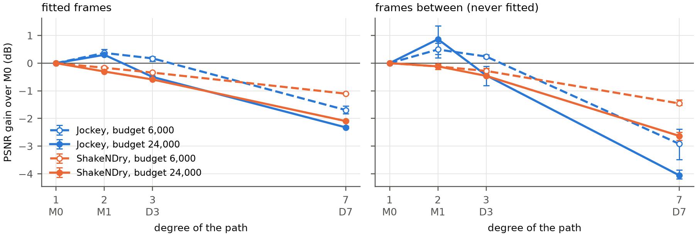

**Figure A2.** Gain over M0 against the degree of the path, with the seed range. The higher the degree, the worse the result, and the drop is larger on the frames between (right), which no model was fitted to.

On the frames between, the higher-degree paths are worse by up to 4 dB: a degree-7 path swings about between the frames it was fitted to. Figure A2 (right) shows the larger drop on the frames between. On Jockey at budget 24,000, D7 loses about 5 dB from the fitted frames to the frames between, while M0 loses 3.4 dB and M1 2.9 dB. The large drop on the frames between shows that the swinging is real.

**Table A12.** Gain over M0 by degree of the path, fully trained, stride 3: mean, lowest and highest over 3 seeds (dB, paired by seed), in three parts by what is scored. M0 PSNR is the baseline's PSNR on the same frames and region (mean of 3 seeds).

*Table A12 (a). Scored on the fitted frames, whole frame.*

| Clip | Budget | M0 PSNR (dB) | Model | Mean | Lowest | Highest |
|---|---:|---:|---|---:|---:|---:|
| Jockey | 6,000 | 25.27 | M1 | +0.37 | +0.30 | +0.50 |
| Jockey | 6,000 | 25.27 | D3 | +0.17 | +0.07 | +0.24 |
| Jockey | 6,000 | 25.27 | D7 | −1.69 | −1.83 | −1.54 |
| Jockey | 24,000 | 28.66 | M1 | +0.30 | +0.26 | +0.39 |
| Jockey | 24,000 | 28.66 | D3 | −0.50 | −0.52 | −0.49 |
| Jockey | 24,000 | 28.66 | D7 | −2.32 | −2.36 | −2.27 |
| ShakeNDry | 6,000 | 24.84 | M1 | −0.17 | −0.21 | −0.12 |
| ShakeNDry | 6,000 | 24.84 | D3 | −0.34 | −0.35 | −0.32 |
| ShakeNDry | 6,000 | 24.84 | D7 | −1.10 | −1.12 | −1.08 |
| ShakeNDry | 24,000 | 27.68 | M1 | −0.30 | −0.31 | −0.29 |
| ShakeNDry | 24,000 | 27.68 | D3 | −0.59 | −0.60 | −0.57 |
| ShakeNDry | 24,000 | 27.68 | D7 | −2.09 | −2.12 | −2.04 |

*Table A12 (b). Scored on the frames between, whole frame.*

| Clip | Budget | M0 PSNR (dB) | Model | Mean | Lowest | Highest |
|---|---:|---:|---|---:|---:|---:|
| Jockey | 6,000 | 24.99 | M1 | +0.49 | +0.32 | +0.73 |
| Jockey | 6,000 | 24.99 | D3 | +0.24 | +0.18 | +0.31 |
| Jockey | 6,000 | 24.99 | D7 | −2.92 | −3.49 | −2.38 |
| Jockey | 24,000 | 25.23 | M1 | +0.87 | +0.20 | +1.35 |
| Jockey | 24,000 | 25.23 | D3 | −0.44 | −0.81 | −0.12 |
| Jockey | 24,000 | 25.23 | D7 | −4.06 | −4.18 | −3.85 |
| ShakeNDry | 6,000 | 24.68 | M1 | −0.12 | −0.22 | −0.02 |
| ShakeNDry | 6,000 | 24.68 | D3 | −0.28 | −0.33 | −0.19 |
| ShakeNDry | 6,000 | 24.68 | D7 | −1.46 | −1.52 | −1.32 |
| ShakeNDry | 24,000 | 27.11 | M1 | −0.12 | −0.15 | −0.09 |
| ShakeNDry | 24,000 | 27.11 | D3 | −0.46 | −0.48 | −0.44 |
| ShakeNDry | 24,000 | 27.11 | D7 | −2.63 | −2.78 | −2.50 |

*Table A12 (c). Scored on the frames between, on the moving object.*

| Clip | Budget | M0 PSNR (dB) | Model | Mean | Lowest | Highest |
|---|---:|---:|---|---:|---:|---:|
| Jockey | 6,000 | 21.32 | M1 | +0.23 | +0.02 | +0.63 |
| Jockey | 6,000 | 21.32 | D3 | −0.19 | −0.37 | −0.01 |
| Jockey | 6,000 | 21.32 | D7 | −2.29 | −2.99 | −1.39 |
| Jockey | 24,000 | 22.97 | M1 | +0.52 | +0.19 | +0.96 |
| Jockey | 24,000 | 22.97 | D3 | −0.08 | −0.37 | +0.10 |
| Jockey | 24,000 | 22.97 | D7 | −2.66 | −3.03 | −2.23 |
| ShakeNDry | 6,000 | 24.12 | M1 | +0.35 | −0.44 | +1.46 |
| ShakeNDry | 6,000 | 24.12 | D3 | +0.37 | −0.03 | +1.12 |
| ShakeNDry | 6,000 | 24.12 | D7 | −0.91 | −1.63 | +0.12 |
| ShakeNDry | 24,000 | 24.63 | M1 | +0.50 | +0.34 | +0.61 |
| ShakeNDry | 24,000 | 24.63 | D3 | +0.21 | −0.02 | +0.37 |
| ShakeNDry | 24,000 | 24.63 | D7 | −0.99 | −1.30 | −0.71 |

Three caveats apply to these results:

- Two causes are mixed here: fewer Gaussians, and paths that swing. Comparing at equal storage includes both on purpose.
- Tuning the learning rate of the higher terms might help D7 a little, but learning rates changed results by about 0.1 dB elsewhere, and D7 is 1 to 2 dB behind.
- This is a smaller version of the planned extension: 2 clips and 2 budgets of 10 frames, instead of the 30-frame clip.

Data: [`degree.csv`](docs/data/csv/degree.csv) (the gains of M1, D3 and D7 on the fitted frames, the frames between and the object).

#### B.5 Longer clip and computational cost

**Table A13.** The 30-frame Jockey clip (stride 1, budgets tripled), 3,000 steps. The gains are larger than on 10 frames; Gaussians live longer on a longer clip and their paths bend more.

| Budget | M0 PSNR (dB) | M1 curved | M2 shrinking | M3 both |
|---:|---:|---:|---:|---:|
| 9,000 | 20.93 | +0.62 | +1.69 | +2.40 |
| 18,000 | 23.25 | +0.80 | +1.27 | +1.88 |
| 36,000 | 25.23 | +0.74 | +1.28 | +1.74 |
| 72,000 | 27.45 | +0.60 | +1.13 | +1.43 |

**Table A14.** Cost at budget 24,000 (10 frames). Storage is equal by design, and every model uses about 150 MB of GPU memory.

| Model | Training step (ms) | Change from M0 (%) | Rendering a frame (ms) |
|---|---:|---:|---:|
| M0 | 17.8 | — | 1.38 |
| M1 | 18.3 | +3 | 1.37 |
| M2 | 19.7 | +11 | 1.48 |
| M3 | 21.2 | +19 | 1.44 |

### C. Motion attribution (Q2)

This group gives the diagnostics for Section 5.2. C.1 holds the main comparisons, where the gains lie and whether they need motion; C.2 and C.3 give the detailed records of what the Gaussians learn and how long they live.

#### C.1 Spatial regions and static-image controls

Where the gains lie in the frame, after 3,000 steps (Table A15) and fully trained (Table A16), and the control with still photographs (Table A17).

**Table A15.** Gain over M0 after 3,000 steps inside the object outline (object) and outside it (background), in dB, mean over the 4 budgets and 3 seeds.

| Clip | Stride | Model | Object | Background |
|---|---:|---|---:|---:|
| Jockey | 1 | M1 curved | +0.11 | +0.39 |
| Jockey | 1 | M2 shrinking | +0.79 | +1.42 |
| Jockey | 1 | M3 both | +0.77 | +1.56 |
| Jockey | 3 | M1 curved | +0.15 | +0.66 |
| Jockey | 3 | M2 shrinking | +0.39 | +0.74 |
| Jockey | 3 | M3 both | +0.57 | +1.23 |
| ShakeNDry | 1 | M1 curved | +0.24 | +0.07 |
| ShakeNDry | 1 | M2 shrinking | +0.57 | +0.51 |
| ShakeNDry | 1 | M3 both | +0.66 | +0.54 |
| ShakeNDry | 3 | M1 curved | +0.28 | +0.10 |
| ShakeNDry | 3 | M2 shrinking | +0.41 | +0.53 |
| ShakeNDry | 3 | M3 both | +0.58 | +0.56 |
| YachtRide | 1 | M1 curved | +0.26 | +0.20 |
| YachtRide | 1 | M2 shrinking | +1.28 | +0.77 |
| YachtRide | 1 | M3 both | +1.28 | +0.86 |
| YachtRide | 3 | M1 curved | +0.32 | +0.25 |
| YachtRide | 3 | M2 shrinking | +0.91 | +0.59 |
| YachtRide | 3 | M3 both | +1.16 | +0.69 |
| Bosphorus | 1 | M1 curved | +0.15 | +0.25 |
| Bosphorus | 1 | M2 shrinking | +0.87 | +0.88 |
| Bosphorus | 1 | M3 both | +0.97 | +1.03 |
| Bosphorus | 3 | M1 curved | +0.29 | +0.22 |
| Bosphorus | 3 | M2 shrinking | +0.93 | +0.74 |
| Bosphorus | 3 | M3 both | +1.12 | +0.97 |

**Table A16.** Fully trained gain over M0 (stride 3) inside the object outline (object) and outside it (background), in dB, mean over the 4 budgets and 3 seeds.

| Clip | Model | Object | Background |
|---|---|---:|---:|
| Jockey | M1 curved | +0.30 | +0.49 |
| Jockey | M2 shrinking | −0.16 | −0.30 |
| Jockey | M3 both | +0.01 | −0.00 |
| ShakeNDry | M1 curved | +0.01 | −0.21 |
| ShakeNDry | M2 shrinking | −0.21 | +0.12 |
| ShakeNDry | M3 both | −0.15 | −0.17 |
| YachtRide | M1 curved | −0.43 | −0.13 |
| YachtRide | M2 shrinking | −0.03 | −0.08 |
| YachtRide | M3 both | −0.37 | −0.21 |
| Bosphorus | M1 curved | −0.29 | −0.19 |
| Bosphorus | M2 shrinking | −0.04 | +0.32 |
| Bosphorus | M3 both | −0.28 | −0.02 |

**Table A17.** Still photographs, 3,000 steps, in two parts. Part (a) gives the gain over M0 on each photograph: mean, lowest and highest over 3 seeds (dB, paired by seed); M0 PSNR is the baseline's PSNR on the still video (mean of 3 seeds). Part (b) compares M2's mean gain on the still photograph with its gain on the same clip in motion (stride 1, 3,000 steps).

*Table A17 (a). Gain over M0 on the still photographs.*

| Photograph | Budget | M0 PSNR (dB) | Model | Mean | Lowest | Highest |
|---|---:|---:|---|---:|---:|---:|
| Jockey | 3,000 | 20.40 | M1 curved | +0.73 | −0.17 | +1.78 |
| Jockey | 3,000 | 20.40 | M2 shrinking | +1.85 | +1.07 | +2.25 |
| Jockey | 3,000 | 20.40 | M3 both | +2.08 | +1.00 | +2.85 |
| Jockey | 12,000 | 25.32 | M1 curved | +0.30 | +0.12 | +0.40 |
| Jockey | 12,000 | 25.32 | M2 shrinking | +1.26 | +1.15 | +1.39 |
| Jockey | 12,000 | 25.32 | M3 both | +1.29 | +1.14 | +1.42 |
| ShakeNDry | 3,000 | 22.50 | M1 curved | +0.13 | +0.11 | +0.14 |
| ShakeNDry | 3,000 | 22.50 | M2 shrinking | +0.64 | +0.55 | +0.68 |
| ShakeNDry | 3,000 | 22.50 | M3 both | +0.60 | +0.53 | +0.67 |
| ShakeNDry | 12,000 | 24.48 | M1 curved | +0.09 | +0.04 | +0.12 |
| ShakeNDry | 12,000 | 24.48 | M2 shrinking | +0.65 | +0.62 | +0.69 |
| ShakeNDry | 12,000 | 24.48 | M3 both | +0.67 | +0.63 | +0.74 |
| YachtRide | 3,000 | 21.86 | M1 curved | +0.33 | +0.19 | +0.46 |
| YachtRide | 3,000 | 21.86 | M2 shrinking | +0.81 | +0.61 | +1.02 |
| YachtRide | 3,000 | 21.86 | M3 both | +0.89 | +0.77 | +1.11 |
| YachtRide | 12,000 | 25.10 | M1 curved | +0.29 | +0.20 | +0.40 |
| YachtRide | 12,000 | 25.10 | M2 shrinking | +1.03 | +0.84 | +1.18 |
| YachtRide | 12,000 | 25.10 | M3 both | +1.11 | +1.01 | +1.20 |
| Bosphorus | 3,000 | 23.74 | M1 curved | +0.18 | +0.02 | +0.27 |
| Bosphorus | 3,000 | 23.74 | M2 shrinking | +0.70 | +0.39 | +1.06 |
| Bosphorus | 3,000 | 23.74 | M3 both | +0.88 | +0.68 | +1.20 |
| Bosphorus | 12,000 | 26.02 | M1 curved | +0.16 | +0.11 | +0.19 |
| Bosphorus | 12,000 | 26.02 | M2 shrinking | +0.84 | +0.79 | +0.89 |
| Bosphorus | 12,000 | 26.02 | M3 both | +0.96 | +0.89 | +1.02 |

*Table A17 (b). M2 − M0 on the still photograph and on the moving clip (dB).*

| Clip | Budget | Still photograph (mean) | Moving clip, stride 1 |
|---|---:|---:|---:|
| Jockey | 3,000 | +1.85 | +2.26 |
| Jockey | 12,000 | +1.26 | +0.87 |
| ShakeNDry | 3,000 | +0.64 | +0.40 |
| ShakeNDry | 12,000 | +0.65 | +0.59 |
| YachtRide | 3,000 | +0.81 | +0.98 |
| YachtRide | 12,000 | +1.03 | +0.92 |
| Bosphorus | 3,000 | +0.70 | +0.83 |
| Bosphorus | 12,000 | +0.84 | +0.85 |

Data: [`still_photographs.csv`](docs/data/csv/still_photographs.csv) (the M0 PSNR and the gains of M1 to M3 on each photograph and budget).

#### C.2 Learned motion parameters

**Table A18.** Acceleration learned by M1's Gaussians against the real acceleration (seed 0, budget 12,000, stride 3, pixels per frame², median). The last column counts Gaussians whose learned acceleration points the same way as the real one; 50% is chance.

| Clip and region | Learned | Real | Same direction |
|---|---:|---:|---:|
| Jockey, horse | 1.33 | 0.83 | 63% |
| Jockey, background | 1.75 | 0.49 | 50% |
| ShakeNDry, dog | 3.06 | 2.56 | 42% |
| ShakeNDry, background | 0.77 | 0.09 | 51% |
| Bosphorus, background | 1.19 | 0.07 | 54% |

Fewer than 1% of Gaussians leave the acceleration unused. Velocity behaves like the acceleration (Table A19): on the still dog clip and on Bosphorus, Gaussians move at 1.5 to 2 pixels per frame in directions unrelated to the real motion. Velocity follows the real motion only where that motion is large and even: the Jockey pan, and YachtRide at stride 3.

**Table A19.** Velocity of M0's Gaussians against the real motion (budget 12,000, median).

| Clip | Stride | Learned speed (px/frame) | Real speed (px/frame) | Direction similarity (1 = same) |
|---|---:|---:|---:|---:|
| Jockey | 1 | 2.8 | 3.7 | 0.84 |
| Jockey | 3 | 3.7 | 5.2 | 0.84 |
| YachtRide | 1 | 1.9 | 0.8 | 0.47 |
| YachtRide | 3 | 2.7 | 2.4 | 0.78 |
| Bosphorus | 1 | 2.0 | 0.5 | −0.01 |
| Bosphorus | 3 | 2.1 | 1.6 | 0.21 |
| ShakeNDry | 1 | 1.5 | 0.04 | 0.50 |
| ShakeNDry | 3 | 1.6 | 0.06 | 0.30 |

#### C.3 Lifetimes and additional diagnostics

**Table A20.** How long Gaussians live (seed 0): the duration $\sigma_t$, and the number of the 10 frames in which a Gaussian is visible (weight above 0.1).

| Clip | Budget | M0: $\sigma_t$ | M0: frames visible | M1: $\sigma_t$ | M1: frames visible |
|---|---:|---:|---:|---:|---:|
| Jockey | 3,000 | 2.67 | 7.7 | 3.33 | 8.2 |
| Jockey | 24,000 | 2.19 | 6.8 | 2.63 | 7.6 |
| ShakeNDry | 24,000 | 2.61 | 7.4 | 3.19 | 8.0 |
| Bosphorus | 24,000 | 2.09 | 6.6 | 2.28 | 6.9 |

Curved Gaussians live 10 to 25% longer, as the proposal guessed. Even M0's Gaussians are visible in about 7 of the 10 frames, though, so a 10-frame clip leaves little room for handing motion from one Gaussian to the next. For every model the worst frame is almost always the first or last one, which has no earlier or later Gaussians to help cover it.

Pixels were also grouped by how much they change from one frame to the next. If shrinking removed blurry trails behind moving things, its gain would sit on the changing pixels. It does not; the gain is spread roughly in proportion to the number of pixels. On Bosphorus, for example, 73% of pixels barely change and they give 66% of the gain.

### D. Temporal interpolation (Q3)

This group gives the material for Section 5.3. The confirmatory test on real clips and the synthetic arcs come first; the exploratory analysis of the real clips, which led to the confirmatory test, follows.

#### D.1 Real-video confirmation

> **The rule, fixed before the runs.** Only the moving object in the frames between is scored. There are 12 cells (3 clips × 2 strides × 2 budgets), and a cell passes if M1 beats M0 for all 3 seeds. With 9 or more passing cells, the curved path counts as a real gain for the frames between; with 3 or fewer, there is no gain; anything in between counts as partly true. It was also predicted that the gain would be larger at stride 5 than at stride 3.

If the curved path had no effect, a cell would pass by luck one time in eight. At stride 5 the motion may be too large for either model to follow.

**Table A21.** The confirmatory test, one row per cell: M1 − M0 on the moving object in the frames between, mean, lowest and highest over 3 seeds, paired by seed (dB). A cell passes when all 3 seeds are above zero; 9 of 12 cells pass.

| Clip | Stride | Budget | Mean | Lowest | Highest | All 3 seeds above zero |
|---|---:|---:|---:|---:|---:|---|
| ShakeNDry from frame 30 (dog) | 3 | 6,000 | +0.57 | +0.33 | +1.03 | Yes |
| ShakeNDry from frame 30 (dog) | 3 | 24,000 | +0.73 | −0.03 | +1.72 | No |
| ShakeNDry from frame 30 (dog) | 5 | 6,000 | +0.31 | −0.69 | +1.23 | No |
| ShakeNDry from frame 30 (dog) | 5 | 24,000 | +0.92 | +0.82 | +1.00 | Yes |
| Jockey from frame 120 | 3 | 6,000 | +0.41 | +0.22 | +0.62 | Yes |
| Jockey from frame 120 | 3 | 24,000 | +0.91 | +0.73 | +1.09 | Yes |
| Jockey from frame 120 | 5 | 6,000 | +0.73 | +0.36 | +1.00 | Yes |
| Jockey from frame 120 | 5 | 24,000 | +0.45 | +0.17 | +0.65 | Yes |
| Jockey from frame 200 | 3 | 6,000 | −0.09 | −0.31 | +0.10 | No |
| Jockey from frame 200 | 3 | 24,000 | +0.31 | +0.21 | +0.39 | Yes |
| Jockey from frame 200 | 5 | 6,000 | +0.05 | +0.01 | +0.13 | Yes |
| Jockey from frame 200 | 5 | 24,000 | +0.45 | +0.36 | +0.61 | Yes |

**Table A22.** M1 − M0 on scores outside the rule: the lowest and highest of the 12 cell means (dB).

| M1 − M0 on | Lowest of the 12 cells | Highest of the 12 cells |
|---|---:|---:|
| Fitted frames, object | −0.12 | +0.33 |
| Frames between, whole frame | −1.04 | +0.48 |
| Fitted frames, whole frame | −0.32 | +0.12 |

Averaged over the six cells of each stride, the gain on the moving object in the frames between is +0.47 dB at stride 3 and +0.49 dB at stride 5.

Data: [`confirmatory_test.csv`](docs/data/csv/confirmatory_test.csv) (the 12 cells, with the mean, lowest and highest gain and the other scores).

#### D.2 Controlled synthetic motion

Before running, four predictions were written down: no gain on the straight line; a gain that grows with the bend; at the largest bend, a gain bigger than the seed spread; and M1's Gaussians on the ball bending the right way well over half the time.

All four predictions hold. On the straight line, M1 is slightly behind (it has 14% fewer Gaussians), and the seed ranges cross zero. The gain grows with the bend at both budgets. At a full turn even the worst seed gains 7.8 or 8.9 dB, far beyond the spread of about ±2 dB on the straight line. M1's Gaussians on the ball bend the right way 91% to 100% of the time, and their acceleration is close to the true one (at 90°, 1.50 to 1.54 against 1.57 pixels per frame²).

**Table A23.** The ball, second version, scored on the ball, in two parts: on the fitted frames and on the frames between. Each part gives M0's PSNR (mean of 3 seeds) and M1 − M0 as mean, lowest and highest over 3 seeds (dB, paired by seed).

*Table A23 (a). Fitted frames, on the ball.*

| Turn | Budget | M0 PSNR (dB) | Mean | Lowest | Highest |
|---|---:|---:|---:|---:|---:|
| 0° (straight) | 6,000 | 25.75 | −1.10 | −2.53 | +0.93 |
| 0° (straight) | 24,000 | 32.92 | −0.69 | −1.56 | +0.90 |
| 90° | 6,000 | 24.21 | +0.58 | −0.35 | +1.52 |
| 90° | 24,000 | 28.70 | +0.86 | +0.07 | +1.92 |
| 180° | 6,000 | 23.39 | +0.86 | −0.05 | +1.75 |
| 180° | 24,000 | 27.72 | +1.32 | +0.99 | +1.70 |
| 270° | 6,000 | 23.67 | +0.38 | −0.01 | +1.06 |
| 270° | 24,000 | 27.25 | +1.29 | +0.88 | +1.91 |
| 360° (full turn) | 6,000 | 23.34 | +1.18 | +0.93 | +1.63 |
| 360° (full turn) | 24,000 | 27.56 | +0.93 | +0.29 | +1.40 |

*Table A23 (b). Frames between, on the ball.*

| Turn | Budget | M0 PSNR (dB) | Mean | Lowest | Highest |
|---|---:|---:|---:|---:|---:|
| 0° (straight) | 6,000 | 25.75 | −1.10 | −2.54 | +0.94 |
| 0° (straight) | 24,000 | 32.95 | −0.69 | −1.57 | +0.92 |
| 90° | 6,000 | 24.22 | +0.71 | −0.26 | +1.74 |
| 90° | 24,000 | 28.02 | +1.40 | +0.74 | +2.61 |
| 180° | 6,000 | 22.45 | +1.85 | +0.09 | +3.38 |
| 180° | 24,000 | 20.55 | +7.90 | +4.65 | +10.12 |
| 270° | 6,000 | 17.16 | +6.85 | +5.36 | +9.14 |
| 270° | 24,000 | 17.76 | +8.08 | +7.15 | +8.99 |
| 360° (full turn) | 6,000 | 14.77 | +9.07 | +7.78 | +11.11 |
| 360° (full turn) | 24,000 | 15.24 | +9.21 | +8.92 | +9.45 |

**Table A24.** Paths of the Gaussians on the ball (mean of 3 seeds): distance from the true path, and for M1 the share that bends the right way. Only 3 to 25 Gaussians per model sit on the ball, so these numbers are rough.

| Turn | Budget | M0 distance (px) | M1 distance (px) | M1 bends the right way |
|---|---:|---:|---:|---:|
| 0° (straight) | 6,000 | 0.01 | 0.04 | — |
| 0° (straight) | 24,000 | 0.03 | 0.02 | — |
| 90° | 6,000 | 1.62 | 0.56 | 100% |
| 90° | 24,000 | 1.92 | 0.63 | 92% |
| 180° | 6,000 | 1.58 | 1.09 | 100% |
| 180° | 24,000 | 2.09 | 0.89 | 96% |
| 270° | 6,000 | 3.52 | 1.34 | 100% |
| 270° | 24,000 | 3.26 | 1.82 | 91% |
| 360° (full turn) | 6,000 | 2.90 | 1.52 | 100% |
| 360° (full turn) | 24,000 | 4.20 | 1.67 | 96% |

Data: [`synthetic_arcs.csv`](docs/data/csv/synthetic_arcs.csv) (M0's PSNR and M1's gain on the ball, on the fitted frames and the frames between, for every turn and budget).

**Development of the test: the first version, the second version and its precondition.** In the first version, the ball moved 30 pixels between fitted frames and its stripes were 9 pixels apart. Neither model could draw the frames between (about 10 dB on the ball, against 29 dB on the fitted frames). The ball was roughly in place but its colours were scrambled, and its Gaussians were 14 to 20 pixels off the path. The stripes moved more than half a period per step, which made the direction of motion ambiguous, so those 60 fits were discarded.

The second version moves the ball 9 pixels between fitted frames, makes it smaller (radius 8) and widens the stripes (period 30). A precondition was added before the runs: on the straight line, M0's frames between must come within 3 dB of its fitted frames. A pilot met it easily (0.03 dB apart, with Gaussian paths within 0.02 pixels of the truth), while a full turn cost M0 7 to 12 dB on the frames between.

#### D.3 Exploratory real-video analysis

At stride 3, a model is fitted to frames 0, 3, 6, … and never sees frames 1, 2, 4, 5, …. Its Gaussians can still be drawn at any time, so those frames were drawn from the 192 fully trained models and compared with the real ones.

On the shaking dog, the curved models draw the frames between better: M1 and M3 are 0.2 to 0.5 dB ahead of M0, while on the fitted frames they are level. All 3 seeds are positive at three of the four budgets. M2, which does not curve, shows no such gain, and on the two straight boat clips the curved path makes the frames between worse. This was the first result that matched the starting expectation. It was found after looking at the data, though; it covers a small region, and at one budget the seeds disagree (−0.44 to +1.46 dB). Section 5.3 tests it on new real clips and on synthetic arcs.

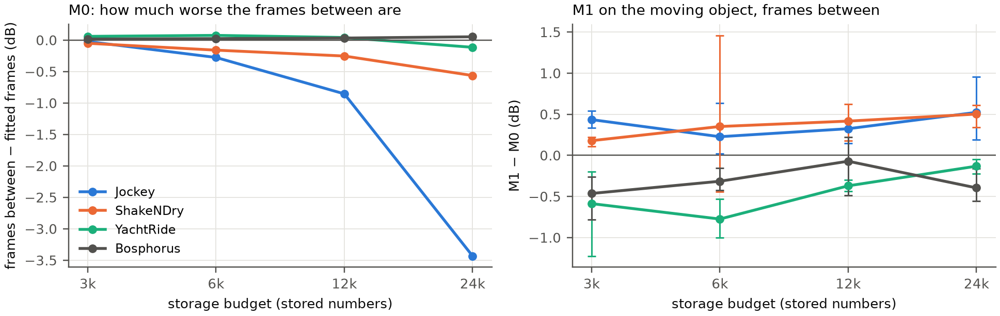

**Figure A3.** Left: how much worse M0 draws the frames between than the fitted frames. On the fast clips (Jockey's pan and the shaking dog), the gap grows with more Gaussians, up to 3.4 dB. Right: M1 against M0 on the moving object in the frames between, with the seed range.

On the two slow boat clips, the frames between are as good as the fitted ones. On the fast clips, extra Gaussians fit the fitted frames more closely without learning the motion. On Jockey, M0's frames between are worse at budget 24,000 (25.2 dB) than at 12,000 (26.1 dB). On the dog, the frames between gain only 0.5 dB from budget 3,000 to 24,000 (24.1 to 24.6 dB), while the fitted frames gain 3 dB.

**Table A25.** M0 fully trained: PSNR on the fitted frames and the frames between, over the whole frame and on the object (dB, mean of 3 seeds).

| Clip | Budget | Whole frame: fitted frames | Whole frame: frames between | Object: fitted frames | Object: frames between |
|---|---:|---:|---:|---:|---:|
| Jockey | 3,000 | 23.43 | 23.41 | 19.90 | 19.86 |
| Jockey | 6,000 | 25.27 | 24.99 | 21.73 | 21.32 |
| Jockey | 12,000 | 26.96 | 26.10 | 23.27 | 22.35 |
| Jockey | 24,000 | 28.66 | 25.23 | 24.92 | 22.97 |
| ShakeNDry | 3,000 | 23.87 | 23.82 | 24.62 | 24.09 |
| ShakeNDry | 6,000 | 24.84 | 24.68 | 25.53 | 24.12 |
| ShakeNDry | 12,000 | 26.09 | 25.84 | 26.50 | 24.67 |
| ShakeNDry | 24,000 | 27.68 | 27.11 | 27.59 | 24.63 |
| YachtRide | 3,000 | 24.44 | 24.50 | 23.60 | 23.69 |
| YachtRide | 6,000 | 26.18 | 26.25 | 25.93 | 26.07 |
| YachtRide | 12,000 | 27.74 | 27.79 | 28.00 | 28.12 |
| YachtRide | 24,000 | 29.38 | 29.26 | 30.10 | 29.98 |
| Bosphorus | 3,000 | 26.90 | 26.92 | 22.34 | 22.34 |
| Bosphorus | 6,000 | 28.25 | 28.27 | 23.83 | 23.84 |
| Bosphorus | 12,000 | 29.94 | 29.97 | 25.44 | 25.49 |
| Bosphorus | 24,000 | 32.08 | 32.13 | 28.01 | 28.10 |

**Table A26.** Gain over M0 over the whole frame, on the fitted frames and on the frames between (dB, mean over the budgets and 3 seeds).

| Clip | Model | Fitted frames | Frames between |
|---|---|---:|---:|
| Jockey | M1 curved | +0.45 | +0.70 |
| Jockey | M2 shrinking | −0.28 | −0.45 |
| Jockey | M3 both | +0.00 | −0.01 |
| ShakeNDry | M1 curved | −0.19 | −0.11 |
| ShakeNDry | M2 shrinking | +0.09 | +0.06 |
| ShakeNDry | M3 both | −0.16 | −0.08 |
| YachtRide | M1 curved | −0.27 | −0.29 |
| YachtRide | M2 shrinking | −0.06 | −0.06 |
| YachtRide | M3 both | −0.28 | −0.32 |
| Bosphorus | M1 curved | −0.21 | −0.22 |
| Bosphorus | M2 shrinking | +0.26 | +0.26 |
| Bosphorus | M3 both | −0.06 | −0.07 |

**Table A27.** Gain over M0 on the moving object, fully trained, stride 3, in two parts. Part (a) gives the gain on the object in the frames between: mean, lowest and highest over 3 seeds (dB, paired by seed). Part (b) sets M1's mean gain on the object in the fitted frames beside its mean gain on the object in the frames between, for comparison.

*Table A27 (a). Gain over M0 on the moving object in the frames between.*

| Clip | Budget | Model | Mean | Lowest | Highest |
|---|---:|---|---:|---:|---:|
| Jockey | 3,000 | M1 curved | +0.43 | +0.34 | +0.54 |
| Jockey | 3,000 | M2 shrinking | −0.01 | −0.08 | +0.11 |
| Jockey | 3,000 | M3 both | +0.29 | +0.12 | +0.49 |
| Jockey | 6,000 | M1 curved | +0.23 | +0.02 | +0.63 |
| Jockey | 6,000 | M2 shrinking | −0.11 | −0.22 | +0.05 |
| Jockey | 6,000 | M3 both | −0.06 | −0.12 | +0.03 |
| Jockey | 12,000 | M1 curved | +0.32 | +0.15 | +0.43 |
| Jockey | 12,000 | M2 shrinking | −0.13 | −0.42 | +0.15 |
| Jockey | 12,000 | M3 both | −0.00 | −0.25 | +0.37 |
| Jockey | 24,000 | M1 curved | +0.52 | +0.19 | +0.96 |
| Jockey | 24,000 | M2 shrinking | +0.10 | −0.14 | +0.22 |
| Jockey | 24,000 | M3 both | +0.30 | +0.08 | +0.67 |
| ShakeNDry | 3,000 | M1 curved | +0.18 | +0.11 | +0.22 |
| ShakeNDry | 3,000 | M2 shrinking | −0.34 | −0.58 | −0.21 |
| ShakeNDry | 3,000 | M3 both | +0.00 | −0.11 | +0.14 |
| ShakeNDry | 6,000 | M1 curved | +0.35 | −0.44 | +1.46 |
| ShakeNDry | 6,000 | M2 shrinking | −0.12 | −0.99 | +0.74 |
| ShakeNDry | 6,000 | M3 both | +0.54 | +0.10 | +1.35 |
| ShakeNDry | 12,000 | M1 curved | +0.42 | +0.17 | +0.62 |
| ShakeNDry | 12,000 | M2 shrinking | −0.01 | −0.74 | +0.36 |
| ShakeNDry | 12,000 | M3 both | +0.17 | −0.03 | +0.48 |
| ShakeNDry | 24,000 | M1 curved | +0.50 | +0.34 | +0.61 |
| ShakeNDry | 24,000 | M2 shrinking | −0.16 | −0.96 | +0.52 |
| ShakeNDry | 24,000 | M3 both | +0.45 | +0.32 | +0.62 |
| YachtRide | 3,000 | M1 curved | −0.59 | −1.22 | −0.20 |
| YachtRide | 3,000 | M2 shrinking | +0.04 | −0.02 | +0.09 |
| YachtRide | 3,000 | M3 both | −0.38 | −0.70 | −0.13 |
| YachtRide | 6,000 | M1 curved | −0.77 | −1.00 | −0.53 |
| YachtRide | 6,000 | M2 shrinking | −0.03 | −0.21 | +0.24 |
| YachtRide | 6,000 | M3 both | −0.49 | −0.77 | −0.28 |
| YachtRide | 12,000 | M1 curved | −0.37 | −0.44 | −0.30 |
| YachtRide | 12,000 | M2 shrinking | −0.08 | −0.13 | −0.02 |
| YachtRide | 12,000 | M3 both | −0.46 | −0.57 | −0.30 |
| YachtRide | 24,000 | M1 curved | −0.13 | −0.22 | −0.05 |
| YachtRide | 24,000 | M2 shrinking | +0.09 | −0.19 | +0.39 |
| YachtRide | 24,000 | M3 both | −0.27 | −0.38 | −0.04 |
| Bosphorus | 3,000 | M1 curved | −0.46 | −0.78 | −0.26 |
| Bosphorus | 3,000 | M2 shrinking | −0.17 | −0.33 | +0.01 |
| Bosphorus | 3,000 | M3 both | −0.09 | −0.47 | +0.10 |
| Bosphorus | 6,000 | M1 curved | −0.32 | −0.42 | −0.15 |
| Bosphorus | 6,000 | M2 shrinking | +0.02 | −0.42 | +0.42 |
| Bosphorus | 6,000 | M3 both | −0.20 | −0.61 | +0.20 |
| Bosphorus | 12,000 | M1 curved | −0.07 | −0.49 | +0.22 |
| Bosphorus | 12,000 | M2 shrinking | +0.02 | −0.29 | +0.20 |
| Bosphorus | 12,000 | M3 both | −0.16 | −0.31 | +0.09 |
| Bosphorus | 24,000 | M1 curved | −0.40 | −0.56 | −0.16 |
| Bosphorus | 24,000 | M2 shrinking | −0.04 | −0.14 | +0.04 |
| Bosphorus | 24,000 | M3 both | −0.76 | −0.81 | −0.70 |

*Table A27 (b). M1 − M0 on the moving object: fitted frames against frames between (dB, mean of 3 seeds).*

| Clip | Budget | Fitted frames | Frames between |
|---|---:|---:|---:|
| Jockey | 3,000 | +0.50 | +0.43 |
| Jockey | 6,000 | +0.23 | +0.23 |
| Jockey | 12,000 | +0.25 | +0.32 |
| Jockey | 24,000 | +0.21 | +0.52 |
| ShakeNDry | 3,000 | −0.09 | +0.18 |
| ShakeNDry | 6,000 | +0.01 | +0.35 |
| ShakeNDry | 12,000 | +0.11 | +0.42 |
| ShakeNDry | 24,000 | −0.01 | +0.50 |
| YachtRide | 3,000 | −0.55 | −0.59 |
| YachtRide | 6,000 | −0.71 | −0.77 |
| YachtRide | 12,000 | −0.36 | −0.37 |
| YachtRide | 24,000 | −0.13 | −0.13 |
| Bosphorus | 3,000 | −0.46 | −0.46 |
| Bosphorus | 6,000 | −0.30 | −0.32 |
| Bosphorus | 12,000 | −0.05 | −0.07 |
| Bosphorus | 24,000 | −0.35 | −0.40 |

**Paths of the dog's Gaussians.** Points on the dog were followed with optical flow through every frame, including the ones the models never saw, and that path was compared with the path of each Gaussian on the dog (M0 and M1, all budgets, 3 seeds, Gaussians with $\sigma_t \ge 0.5$). The method was first checked on the synthetic arc (Appendix D.2), whose path is known: it gets the bending direction right 99% of the time, but positions drift by 3 to 6 pixels over 6 frames.

**Table A28.** M1's Gaussians on ShakeNDry (mean of 3 seeds): the share whose acceleration bends the same way as the real path. 50% is chance.

| Budget | On the dog | On the background |
|---:|---:|---:|
| 3,000 | 47% | 52% |
| 6,000 | 47% | 56% |
| 12,000 | 57% | 62% |
| 24,000 | 57% | 57% |

**Table A29.** Mean distance between each Gaussian's path and the real path, ShakeNDry (pixels).

| Budget | M0: dog | M0: background | M1: dog | M1: background |
|---:|---:|---:|---:|---:|
| 3,000 | 5.65 | 0.23 | 4.52 | 0.22 |
| 6,000 | 6.84 | 0.16 | 5.06 | 0.16 |
| 12,000 | 6.55 | 0.12 | 6.44 | 0.12 |
| 24,000 | 6.58 | 0.09 | 7.00 | 0.10 |

On Jockey the share is 66% to 70% on the horse, but about the same on the background (63% to 78%), which points to the camera rather than the legs.

On the dog, M1's Gaussians bend the right way 47% to 57% of the time, about what chance gives, and their path errors (4.5 to 7 pixels) are about as large as the error of the measurement. Fur and spraying water make flow tracking hard, which makes this a weak check; a clip with a known path is a stronger one.

**Rendered crops.** Figure A4 shows rendered crops of the two moving objects at a fitted frame and at the following frame, which no model saw.

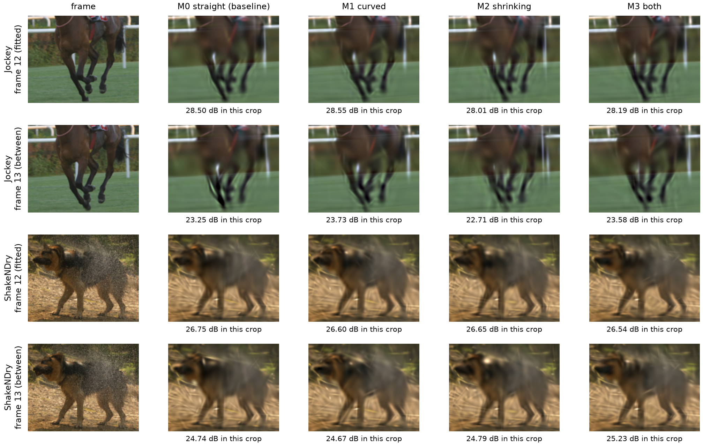

**Figure A4.** The horse's legs and the dog, fully trained, budget 24,000, seed 0, at a fitted frame (12) and at the next frame (13), which no model saw. The numbers are the PSNR inside each crop.

---

## References

- CP4282 course notes, [Unit 16: 2D Gaussians for Images and Videos](https://weitsang.github.io/gaussian-splatting-notes/unit-16/); Unit 14: Compaction of 3DGS.
- W. Smolak-Dyżewska, D. Malarz, K. Howil, J. Kaczmarczyk, M. Mazur, P. Spurek. [VeGaS: Video Gaussian Splatting](https://arxiv.org/abs/2411.11024). arXiv:2411.11024, 2024.
- X. Zhang et al. [GaussianImage: 1000 FPS Image Representation and Compression by 2D Gaussian Splatting](https://arxiv.org/abs/2403.08551). ECCV 2024.
- A. Mercat, M. Viitanen, J. Vanne. [UVG dataset: 50/120fps 4K sequences for video codec analysis and development](https://doi.org/10.1145/3339825.3394937). ACM MMSys 2020. [Dataset page](https://ultravideo.fi/dataset.html). (Videos under CC BY-NC 3.0.)
- G. Farnebäck. [Two-frame motion estimation based on polynomial expansion](https://doi.org/10.1007/3-540-45103-X_50). SCIA 2003.
- K. He, G. Gkioxari, P. Dollár, R. Girshick. [Mask R-CNN](https://arxiv.org/abs/1703.06870). ICCV 2017.
- Z. Li, A. Aaron, I. Katsavounidis, A. Moorthy, M. Manohara. [Toward a practical perceptual video quality metric](https://medium.com/netflix-techblog/toward-a-practical-perceptual-video-quality-metric-653f208b9652) (VMAF). Netflix Tech Blog, 2016.
- D. P. Kingma, J. Ba. [Adam: A method for stochastic optimization](https://arxiv.org/abs/1412.6980). ICLR 2015.
- Z. Wang, A. Bovik, H. Sheikh, E. P. Simoncelli. [Image quality assessment: from error visibility to structural similarity](https://doi.org/10.1109/TIP.2003.819861). IEEE Transactions on Image Processing, 2004.
